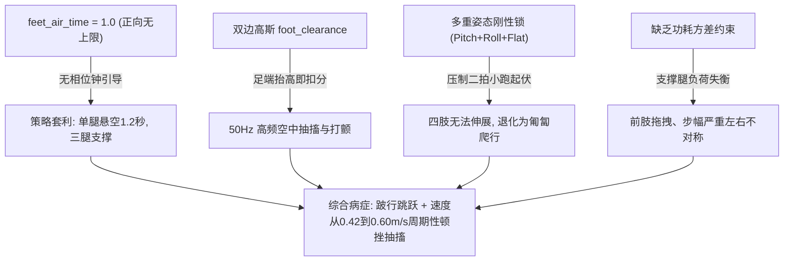

# DreamWaQ Go2 强化学习步态与动力学重构完全教学手册（小白进阶版）

> **文档定位**：以**“小白视角、工程直觉、物理落地三合一”**全面拆解 Unitree Go2 四足机器人基于 **DreamWaQ (CENet + VAE 动力学重构)** 架构的纯本体感觉盲走运控机理与实战调优。  
> **适用机型**：Unitree Go2 四足机器人（12 自由度关节电机 + 6 轴 IMU）  
> **仿真与算法框架**：IsaacLab (Omniverse PhysX) + RSL-RL (PPO + DreamWaQ CENet 变分自编码器网络)  
> **关联参考工程**：
> - DreamWaQ 源码基线：[`dreamwaq_lab/`](file:///home/rum/dreamwaq_lab/) (上游源: [Qinzx03/DreamWaQ_Lab](https://github.com/Qinzx03/DreamWaQ_Lab))
> - 开源复刻鼻祖（Go1 楼梯满分模型）: [Manaro-Alpha/DreamWaQ](https://github.com/Manaro-Alpha/DreamWaQ) ([`reference_repos/Manaro-Alpha_DreamWaQ`](file:///home/rum/reference_repos/Manaro-Alpha_DreamWaQ))
> - Go2 15cm 台阶两阶段训练工程: [WaxberryS/DreamWaq_train_go2](https://github.com/WaxberryS/DreamWaq_train_go2) ([`DreamWaq_train_go2`](file:///home/rum/DreamWaq_train_go2))
> - Go2 MuJoCo 真实 Sim2Sim 部署套件: [WaxberryS/DreamWaQ-sim2sim_go2](https://github.com/WaxberryS/DreamWaQ-sim2sim_go2) ([`reference_repos/DreamWaQ-sim2sim_go2`](file:///home/rum/reference_repos/DreamWaQ-sim2sim_go2))
> - 实机部署轮足/Go2落地开源: [yusongmin1/Dreamwaq](https://github.com/yusongmin1/Dreamwaq) ([`reference_repos/yusongmin1_Dreamwaq`](file:///home/rum/reference_repos/yusongmin1_Dreamwaq))
> - HIMLoco 黄金工程与 10cm 台阶基准：[`himloco_lab/`](file:///home/rum/himloco_lab/)
> - 生产运维规范与避坑红线：[agent.md](file:///home/rum/isaac/agent.md)
> - HIMLoco 原理参考手册：[Himloco.md](file:///home/rum/isaac/Himloco.md)

---

## 目录

- [1. 零基础导读与知识导航](#ch1)
  - [1.1 核心学习目标](#sec-1-1)
  - [1.2 全篇知识树总览](#sec-1-2)
- [2. 算法范式演进：从 RMA、HIMLoco 到 DreamWaQ](#ch2)
  - [2.1 四足无视觉盲走的三大流派对比](#sec-2-1)
  - [2.2 为什么 DreamWaQ 执着于“重构动力学”（VAE vs 对比聚类）](#sec-2-2)
  - [2.3 CENet 的核心设计哲学：隐变量必须预测未来](#sec-2-3)
- [3. CENet 神经网络架构深度拆解](#ch3)
  - [3.1 共享时序编码器（Shared History Encoder）](#sec-3-1)
  - [3.2 显式线速度回归头（3维确定性估计）](#sec-3-2)
  - [3.3 隐变量分布头与重参数化（16维高斯潜空间）](#sec-3-3)
  - [3.4 Clean Proprioception 预测解码器（Decoder）](#sec-3-4)
  - [3.5 联合多任务损失函数（速度 MSE + 重构 MSE + $\beta$-VAE KL）](#sec-3-5)
- [4. 感官解码：DreamWaQ 45 维观测拓扑与时序重排](#ch4)
  - [4.1 45 维本体观测通道详解（警惕与 HIMLoco 的顺序陷阱！）](#sec-4-1)
  - [4.2 5 帧时序（225维）与 Term-Major / Frame-Major 重排机理](#sec-4-2)
  - [4.3 Actor 与 Critic 输入构建全景图](#sec-4-3)
- [5. 物理引擎与系统时钟](#ch5)
  - [5.1 200Hz 物理积分与 50Hz 策略时钟的协同](#sec-5-1)
  - [5.2 200Hz vs 500Hz 对障碍冲击判定的物理影响](#sec-5-2)
  - [5.3 域随机化（Domain Randomization）矩阵](#sec-5-3)
- [6. 训练加速黑科技：AdaBoot 自适应速度自举](#ch6)
  - [6.1 什么是冷启动困境？Actor 与 Estimator 的鸡生蛋蛋生鸡](#sec-6-1)
  - [6.2 AdaBoot 概率注入机制与自适应退火](#sec-6-2)
  - [6.3 Detach 梯度截断与双独立优化器架构](#sec-6-3)
- [7. 避坑红线复盘：DreamWaQ 现有配置与越障断层分析](#ch7)
  - [7.1 现有配置中的 W4 致命雷区（水平与恒高约束）](#sec-7-1)
  - [7.2 越障反射缺失分析（自适应净空与立面逃逸）](#sec-7-2)
  - [7.3 从粗糙地面到连续台阶的奖励重构蓝图](#sec-7-3)
- [8. 核心代码拓扑与精读](#ch8)
  - [8.1 dreamwaq_modules.py（CENet 核心实现）](#sec-8-1)
  - [8.2 dreamwaq_actor_critic.py（非对称数据流）](#sec-8-2)
  - [8.3 dreamwaq_ppo.py（双优化器与 AdaBoot 调度）](#sec-8-3)
  - [8.4 go2_env_cfg.py（环境、观测与奖励）](#sec-8-4)
  - [8.5 dreamwaq_exporter.py（端到端融合导出）](#sec-8-5)
- [9. 动手实战与运维 SOP](#ch9)
  - [9.1 观测维度与张量对齐核验 SOP](#sec-9-1)
  - [9.2 启动无头训练与 TensorBoard 监视](#sec-9-2)
  - [9.3 回放与端到端模型打包部署](#sec-9-3)
- [10. 开源实战进阶：LeggedGym-Ex 多仿真器体系与 24 维显式复合估计](#ch10)
  - [10.1 24 维显式估计 + 16 维隐变量复合架构](#sec-10-1)
  - [10.2 多仿真器抽象与 IsaacLab 适配原理](#sec-10-2)
  - [10.3 训练启动与导出部署 SOP](#sec-10-3)
  - [10.4 避坑红线复查（针对 LeggedGym-Ex 的特别提醒）](#sec-10-4)
- [11. dreamwaq_lab 原生二次开发实战（平地丝滑 + 爬楼梯落地版）](#ch11)
  - [11.1 核心动力学与奖励重构四部曲](#sec-11-1)
  - [11.2 温和渐进阶梯课程](#sec-11-2)
  - [11.3 3000 轮全量训练实测收敛指标](#sec-11-3)
  - [11.4 部署包导出与端到端交付（JIT / ONNX）](#sec-11-4)
- [12. 四大开源复刻成功案例全景对比与技术归因手册](#ch12)
  - [12.1 四大开源复刻项目网址与资产清单](#sec-12-1)
  - [12.2 四大工程核心技术参数与奖励配置横向对比](#sec-12-2)
  - [12.3 为什么早期 DreamWaQ 走得烂？四大物理死穴深度归因](#sec-12-3)
  - [12.4 下一步工程落地路线与实施方案](#sec-12-4)

---

<a id="ch1"></a>
## 1. 零基础导读与知识导航

<a id="sec-1-1"></a>
### 1.1 核心学习目标

通过本手册与后续实战训练，我们将逐步掌握：
1. **搞透 DreamWaQ 的隐式动力学推断**：理解 CENet 是如何利用 5 帧历史本体感知同时推算“我在跑多快”（显式速度）和“我脚下踩着什么地形”（隐变量）；
2. **掌握 $\beta$-VAE 重构在运控中的本质作用**：为什么通过重构下一拍的 Clean Proprioception 能逼迫神经网络学习接触阻抗与外力扰动；
3. **识别并化解两大框架的协议冲突**：彻底理清 DreamWaQ 与 HIMLoco 在 45 维通道排布、时钟频率、时序长度和导出规范上的本质差异；
4. **攻克越障性能迁移难题**：在保留 DreamWaQ 端到端 CENet 优雅表征的同时，将 `himloco_lab` 中验证成熟的越障势场注入 DreamWaQ，打造更强健的 Go2 运控大脑。

---

<a id="sec-1-2"></a>
### 1.2 全篇知识树总览

```
DreamWaQ 核心知识树
├── 1. 算法与表征范式
│   ├── RMA (两阶段显式蒸馏) ──> 训练成本高、两阶段误差累积
│   ├── HIMLoco (单阶段 SwAV 对比聚类) ──> 几何触觉聚类、无解码器
│   └── DreamWaQ (单阶段 CENet VAE 重构) ──> 动力学重构预测、隐式自编码
├── 2. CENet 神经网络拓扑
│   ├── 输入：5 帧本体历史 (225维 Frame-major)
│   ├── 共享主干：MLP 编码器 (128 -> 64)
│   ├── 分支一：确定性线速度回归头 (3维，强监督)
│   ├── 分支二：高斯分布隐变量头 (16维 mu/logvar, Reparameterization)
│   └── 解码器：[v_hat, z] (19维) ──> 重构下一时刻 Clean 观测 (45维)
├── 3. 观测与时钟系统
│   ├── 45 维通道：[ang_vel(3), gravity(3), cmd(3), joint_pos(12), joint_vel(12), last_act(12)]
│   ├── 双速率时钟：策略 50Hz (dt=0.02s) / 物理 200Hz (dt=0.005s, decimation=4)
│   └── 训练自举：AdaBoot (前期真实速度辅助注入，后期退火至纯估计)
└── 4. 交付与导出
    └── 端到端融合导出：(current_obs, history_obs) ──> policy.pt / policy.onnx (内置 CENet)
```

---

<a id="ch2"></a>
## 2. 算法范式演进：从 RMA、HIMLoco 到 DreamWaQ

<a id="sec-2-1"></a>
### 2.1 四足无视觉盲走的三大流派对比

四足机器人纯靠关节磁编码器与 IMU 进行高动态盲走越障，核心难点在于**“未建模扰动与不可直接观测变量”**（例如真实的机身前向速度、地表摩擦力、泥泞阻抗、台阶立面碰撞）。学术界与工业界经历了三次典型进化：

1. **RMA (Rapid Motor Adaptation, 2021)**：
   - **两阶段法**：Phase 1 训练一个吃特权信息（高程图、真实外力）的特权 Teacher；Phase 2 训练一个 Student 用历史观测去模仿 Teacher 的隐向量；
   - *痛点*：训练繁琐，分两步走，第二阶段模仿存在累积漂移。
2. **HIMLoco (ICLR 2024)**：
   - **单阶段无监督对比聚类**：取消两阶段蒸馏。引入 SwAV（Swapping Assignments between Views）对比学习，将两路微扰历史映射到离散聚类原型；
   - *特点*：不尝试“预测未来”，只对“当前触觉阻抗模式”做聚类。
3. **DreamWaQ (IEEE T-RO 2023 / CoRL 2021)**：
   - **单阶段 VAE 动力学重构 (CENet)**：结合显式速度回归与隐式变分自编码器；
   - *核心假设*：如果隐变量 $\mathbf{z}_t$ 足以表征当前环境（坡度、阻抗、外力），那么**只需将 $[ \hat{\mathbf{v}}_t, \mathbf{z}_t ]$ 喂给解码器，网络就应当能够精确重构出机器人下一拍的全身运动状态**！

---

<a id="sec-2-2"></a>
### 2.2 为什么 DreamWaQ 执着于“重构动力学”（VAE vs 对比聚类）

- **SwAV 对比聚类的优势与盲区**：
  - 优势：不需要 Decoder，计算极快；
  - 盲区：对比聚类容易受到数据增强分布的强影响，若扰动设计不当，隐空间可能学到无关捷径特征。
- **VAE 重构的动力学物理直觉**：
  - 解码器的目标是：仅凭当前的估计速度 $\hat{\mathbf{v}}$ 与隐向量 $\mathbf{z}$，预测出下一时刻的无噪声关节角度、角速度与 IMU 投影；
  - 这逼迫隐向量 $\mathbf{z}$ 必须成为一个**“系统动力学参数包”**（包含虚拟质量偏差、电机响应延迟、地面支持反力分布等），使得 Actor 策略网络能感知到最真实的接触动力学。

---

<a id="sec-2-3"></a>
### 2.3 CENet 的核心设计哲学：隐变量必须预测未来

四足机器人奔跑时，外部环境的变化（如踩到结冰地面、陷入草地泥坑、脚尖蹭到台阶边缘）对机器狗而言是**不可直接观测的（Partially Observable）**。

在 DreamWaQ 中，作者提出了一个极其优雅的假设：
> **“如果一个 16 维隐向量 $\mathbf{z}_t$ 确实完整概括了当前机器狗面临的外部环境与动力学扰动，那么给出一个确定性的速度估计 $\hat{\mathbf{v}}_t$ 和这个隐向量 $\mathbf{z}_t$，我们应该能够通过一个简单的多层感知机（Decoder），精准预测出机器人下一时刻的所有运动状态 $\mathbf{s}_{t+1}$！”**

这一设计哲学使得 CENet 的隐空间具有了扎实的**动力学一致性（Dynamic Consistency）**：
- 它不仅仅是在隐空间做几何聚类（像 SwAV 那样找模式相似度）；
- 它更像是一个微型的**“前向动力学仿真器”**（Forward Dynamics Model），逼迫隐变量 $\mathbf{z}_t$ 存储如摩擦系数、接触阻抗、外力扰动以及足端受阻等真实物理上下文。

---

<a id="ch3"></a>
## 3. CENet 神经网络架构深度拆解（代码逐行与数学解析）

在 `scripts/rsl_rl/dreamwaq/dreamwaq_modules.py` 中，DreamWaQ 的核心表征提取器被封装为 `DreamWaQCENet` 类。下面我们从数学公式与代码实现双重视角逐层拆解。

### 3.1 共享时序编码器（Shared History Encoder）

```
输入：225 维时序观测 (5 帧 × 45 维本体感知，Frame-major 格式)
  │
  ▼ Linear(225 -> 128) + ELU()
  ▼ Linear(128 -> 64) + ELU()
  │
输出：64 维编码器特征向量 features
```

- **数学表达**：
  $$\mathbf{f}_t = \text{EncoderBackbone}(\mathbf{h}_t) \in \mathbb{R}^{64}$$
  其中 $\mathbf{h}_t \in \mathbb{R}^{225}$ 为过去 5 帧本体感知的时序堆叠。
- **源码映射**（[`dreamwaq_modules.py:118`](file:///home/rum/dreamwaq_lab/scripts/rsl_rl/dreamwaq/dreamwaq_modules.py#L118)）：
  ```python
  self.encoder, encoder_feature_dim = build_backbone(history_dim, encoder_hidden_dims, activation)
  ```
  该主干网络参数被显式测速任务与隐式环境表征任务**完全共享**。

---

### 3.2 显式线速度回归头（3维确定性估计）

- **数学表达**：
  $$\hat{\mathbf{v}}_t = \mathbf{W}_v \mathbf{f}_t + \mathbf{b}_v \in \mathbb{R}^{3} \quad (\hat{v}_x, \hat{v}_y, \hat{v}_z)$$
- **为什么速度头是确定性输出（Deterministic），而不做高斯采样？**
  - **物理真实性**：机身线速度是物理刚体动量在笛卡尔坐标系下的投影，属于严格单值连续状态，而不是具有多模态不确定性的隐分布；
  - **运控平稳性**：如果像传统 VAE 那样对速度也加上高斯噪声采样，喂给下游 Actor 策略网络的就是带有高频抖动跳变的速度输入，会导致 12 个电机输出 bang-bang 式的高频神经抽搐。
- **源码映射**（[`dreamwaq_modules.py:120`](file:///home/rum/dreamwaq_lab/scripts/rsl_rl/dreamwaq/dreamwaq_modules.py#L120) 与 [`line 170`](file:///home/rum/dreamwaq_lab/scripts/rsl_rl/dreamwaq/dreamwaq_modules.py#L170)）：
  ```python
  self.velocity_mu_head = nn.Linear(encoder_feature_dim, estimated_velocity_dim)
  # 前向传播中直接作为确定性速度估计：
  estimated_velocity = velocity_mu
  ```

---

### 3.3 隐变量分布头与重参数化（16维高斯潜空间）

隐变量 $\mathbf{z}_t$ 建模为对角高斯分布 $\mathcal{N}(\boldsymbol{\mu}_z, \operatorname{diag}(\boldsymbol{\sigma}_z^2))$：
- **均值与对数方差网络**：
  $$\boldsymbol{\mu}_z = \mathbf{W}_{\mu} \mathbf{f}_t + \mathbf{b}_{\mu} \in \mathbb{R}^{16}$$
  $$\log \boldsymbol{\sigma}_z^2 = \operatorname{Hardtanh}_{[-5, 5]}(\mathbf{W}_{\sigma} \mathbf{f}_t + \mathbf{b}_{\sigma}) \in \mathbb{R}^{16}$$
- **工程避坑细节：为什么对 $\log \boldsymbol{\sigma}_z^2$ 强加 Hardtanh 截断？**
  在神经网络训练早期，梯度震荡极容易让方差预测层输出极大或极小的负值。如果不做限制：
  - 若 $\log \sigma^2 > 88$，浮点指数运算 $\exp(0.5 \log \sigma^2)$ 直接溢出为 `Inf` 或 `NaN`，导致整个模型梯度爆炸崩溃；
  - 若 $\log \sigma^2 < -20$，标准差逼近 0，网络退化为确定性映射，失去变分泛化性。
  代码中严格将其锁定在 $[-5.0, 5.0]$ 之间，对应 $\sigma \in [\exp(-2.5), \exp(2.5)] \approx [0.082, 12.18]$，保证了极高的数值稳定性。
- **重参数化技巧（Reparameterization Trick）**：
  $$\mathbf{z}_t = \boldsymbol{\mu}_z + \boldsymbol{\epsilon} \odot \exp\left(0.5 \log \boldsymbol{\sigma}_z^2\right), \quad \boldsymbol{\epsilon} \sim \mathcal{N}(\mathbf{0}, \mathbf{I}_{16})$$
  - **训练阶段**：启用采样（`sample_latent=True`），使隐空间保持连续平滑，便于变分推断；
  - **控制与推理阶段**：强制置零噪声（`sample_latent=False`），直接返回均值 $\mathbf{z}_t = \boldsymbol{\mu}_z$！这保证了策略在真机部署与推理时的完全确定性。
- **源码映射**（[`dreamwaq_modules.py:127-156`](file:///home/rum/dreamwaq_lab/scripts/rsl_rl/dreamwaq/dreamwaq_modules.py#L127-L156)）：
  ```python
  @staticmethod
  def reparameterize(mu: torch.Tensor, logvar: torch.Tensor, sample: bool) -> torch.Tensor:
      if not sample:
          return mu
      std = torch.exp(0.5 * logvar)
      eps = torch.randn_like(std)
      return mu + eps * std
  ```

---

### 3.4 Clean Proprioception 预测解码器（Decoder）

- **输入通道**：
  $$\mathbf{c}_t = [ \hat{\mathbf{v}}_t, \, \mathbf{z}_t ] \in \mathbb{R}^{3 + 16} = \mathbb{R}^{19}$$
- **网络结构**：
  $$\hat{\mathbf{s}}_{t+1} = \text{Decoder}(\mathbf{c}_t): \quad \mathbb{R}^{19} \xrightarrow{\text{MLP}(128, 128)} \mathbb{R}^{45}$$
- **物理目标解析**：
  解码器输出 45 维向量 $\hat{\mathbf{s}}_{t+1}$，其监督目标不是当前帧的观测，而是**下一时间步的无噪声本体感知（Next Clean Proprioception）**：
  $$\mathbf{s}_{t+1}^{\text{clean}} = [ \boldsymbol{\omega}_{b, t+1}, \, \mathbf{g}_{b, t+1}, \, \mathbf{v}_{\text{cmd}, t+1}, \, \mathbf{q}_{t+1} - \mathbf{q}_{\text{nom}}, \, \dot{\mathbf{q}}_{t+1}, \, \mathbf{a}_t ]$$
- **为什么一定要重构“无噪声的目标”？**
  - 在强化学习中，为了 Sim2Sim 泛化，Actor 观测中注入了大量传感器均匀噪声（如关节速度加了 $\pm 1.5\,\text{rad/s}$ 噪声）；
  - 如果 Decoder 去逼近带噪声的观测，CENet 就会浪费模型容量去拟合高斯白噪声；
  - 逼近 Clean 真实物理值，等价于赋予了 CENet **卡尔曼滤波去噪（Denoising）与物理前向模拟**的双重能力！

---

### 3.5 联合多任务损失函数（速度 MSE + 重构 MSE + $\beta$-VAE KL）

在每个更新步中，CENet 产生三个维度的辅助损失（[`dreamwaq_actor_critic.py:592-596`](file:///home/rum/dreamwaq_lab/scripts/rsl_rl/dreamwaq/dreamwaq_actor_critic.py#L592-L596)）：

$$\mathcal{L}_{\text{CENet}} = w_v \mathcal{L}_{\text{vel}} + w_r \mathcal{L}_{\text{recon}} + w_{\text{kl}} \cdot \beta \cdot \mathcal{L}_{\text{KL}}$$

#### 1. 显式线速度回归损失：
$$\mathcal{L}_{\text{vel}} = \frac{1}{|\mathcal{B}_{\text{valid}}|} \sum_{i \in \mathcal{B}_{\text{valid}}} \|\hat{\mathbf{v}}_i - \mathbf{v}_i^{\text{true}}\|^2$$
其中真实速度 $\mathbf{v}_i^{\text{true}}$ 直接从特权 Critic 观测通道切片获取。

#### 2. 下一步动力学重构损失：
$$\mathcal{L}_{\text{recon}} = \frac{1}{|\mathcal{B}_{\text{valid}}|} \sum_{i \in \mathcal{B}_{\text{valid}}} \|\hat{\mathbf{s}}_{t+1, i} - \mathbf{s}_{t+1, i}^{\text{clean}}\|^2$$

#### 3. 隐变量变分正则化（KL 散度）：
根据解析公式计算高斯分布与标准正态分布 $\mathcal{N}(\mathbf{0}, \mathbf{I})$ 的 KL 散度：
$$\mathcal{L}_{\text{KL}} = \frac{1}{|\mathcal{B}_{\text{valid}}|} \sum_{i \in \mathcal{B}_{\text{valid}}} \left[ -\frac{1}{2} \sum_{j=1}^{16} \left( 1 + \log \sigma_{i, j}^2 - \mu_{i, j}^2 - \exp(\log \sigma_{i, j}^2) \right) \right]$$

#### 4. 关键工程边界：死亡与重置样本掩码 (`live_mask`)
注意代码第 567~584 行的处理：
如果机器人发生侧翻或时间耗尽（$d_t = 1$），环境会在下一帧被瞬间重置到原点或随机姿态。此时的 $\mathbf{s}_{t+1}$ 是“瞬移重置状态”，跟上一帧的物理动作毫无因果关联！
代码通过 `live_mask = 1.0 - dones.float()` 严格剔除了重置样本：
```python
valid = live_mask.reshape(-1) > 0.5
velocity_loss = F.mse_loss(velocity_pred[valid], velocity_target[valid])
reconstruction_loss = F.mse_loss(reconstruction_pred[valid], reconstruction_target[valid])
```
这彻底杜绝了环境瞬间重置产生的阶跃异常梯度污染 CENet 的动力学理解。

---

<a id="ch4"></a>
## 4. 感官解码：DreamWaQ 45 维观测拓扑与时序重排

<a id="sec-4-1"></a>
### 4.1 45 维本体观测通道详解（警惕与 HIMLoco 的顺序陷阱！）

这是开发者在两个工程之间迁移时**最容易引发重大事故的雷区**。两者单步虽然都是 45 维，但**前 9 维排布完全不一致**！

| 维度索引 | HIMLoco (`himloco_lab`) 通道与缩放 | DreamWaQ (`dreamwaq_lab`) 通道与缩放 | 硬件传感器物理来源 |
| :---: | :--- | :--- | :--- |
| **`0:3`** | **速度指令 $\mathbf{v}_{\text{cmd}}$**（Scale: `(2.0, 2.0, 0.25)`） | **机身角速度 $\boldsymbol{\omega}_b$**（Scale: `0.2`） | IMU 陀螺仪 / 顶层遥控器手柄 |
| **`3:6`** | **机身角速度 $\boldsymbol{\omega}_b$**（Scale: `0.25`） | **重力矢量投影 $\mathbf{g}_b$**（Scale: `1.0`） | 6 轴 IMU 重力加速度计 |
| **`6:9`** | **重力矢量投影 $\mathbf{g}_b$**（Scale: `1.0`） | **速度指令 $\mathbf{v}_{\text{cmd}}$**（Scale: `1.0`） | 顶层速度手柄输入 |
| **`9:21`** | **关节位置偏差 $\mathbf{q} - \mathbf{q}_{\text{nom}}$**（12维） | **关节位置偏差 $\mathbf{q} - \mathbf{q}_{\text{nom}}$**（12维） | 12 个电机绝对值编码器 |
| **`21:33`** | **关节转动速度 $\dot{\mathbf{q}}$**（12维，Scale: `0.05`） | **关节转动速度 $\dot{\mathbf{q}}$**（12维，Scale: `0.05`） | 12 个电机速度传感器 |
| **`33:45`** | **上一时刻网络动作 $\mathbf{a}_{t-1}$**（12维） | **上一时刻网络动作 $\mathbf{a}_{t-1}$**（12维） | 策略输出缓存 Ring Buffer |

> [!WARNING] **重度致命警告**
> 1. DreamWaQ 将机身角速度放在最前（`0:3`），速度指令排在第 `6:9`；而 HIMLoco 将指令排在最前（`0:3`）；
> 2. HIMLoco 对线速度指令做了 `2.0` 的缩放放大，而 DreamWaQ 的指令缩放为 `1.0`；
> 3. 若直接把 HIMLoco 的观测张量喂给 DreamWaQ 模型，机器人会把遥控器前进摇杆指令当成 IMU 旋转角速度，直接暴走翻车！

---

<a id="sec-4-2"></a>
### 4.2 5 帧时序（225维）与 Term-Major / Frame-Major 重排机理

IsaacLab 的 `ObservationGroupCfg` 管理器有一个底层特性：当设置 `history_length = 5` 且 `flatten_history_dim = True` 时，IsaacLab 会按**“特征项优先（Term-major）”**的格式拼接张量：

```
【IsaacLab 原始输出：Term-major (225维)】
[
  ang_vel(5帧x3=15维), 
  gravity(5帧x3=15维), 
  cmd(5帧x3=15维), 
  joint_pos(5帧x12=60维), 
  joint_vel(5帧x12=60维), 
  actions(5帧x12=60维)
]
```

然而，神经网络理解时序最符合因果逻辑的方式是**“时间帧优先（Frame-major）”**：
```
【CENet 期望输入：Frame-major (225维)】
[
  Frame_{t-4} (45维完整观测),
  Frame_{t-3} (45维完整观测),
  Frame_{t-2} (45维完整观测),
  Frame_{t-1} (45维完整观测),
  Frame_{t}   (45维完整观测)
]
```

#### 代码实现与张量变换推导（[`dreamwaq_actor_critic.py:282-301`](file:///home/rum/dreamwaq_lab/scripts/rsl_rl/dreamwaq/dreamwaq_actor_critic.py#L282-L301)）：

```python
def _term_major_history_to_frame_major(self, history_obs: torch.Tensor) -> torch.Tensor:
    term_chunks: list[torch.Tensor] = []
    cursor = 0
    # term_dims = (3, 3, 3, 12, 12, 12)
    for term_dim in self.history_term_dims:
        chunk_size = self.history_length * term_dim  # 如 5 * 12 = 60
        term_chunk = history_obs[..., cursor : cursor + chunk_size]
        # 重塑为 [batch, 5, term_dim]
        term_chunks.append(term_chunk.reshape(*history_obs.shape[:-1], self.history_length, term_dim))
        cursor += chunk_size
    
    # 在特征维度合并所有 term: [batch, 5, 45]
    frame_major = torch.cat(term_chunks, dim=-1)
    # 展平回 [batch, 225]
    return frame_major.reshape(*history_obs.shape[:-1], self.history_obs_dim)
```
这一步保证了进入 CENet Encoder 的每一块切片，在时空物理结构上都是严格对齐的。

---

<a id="sec-4-3"></a>
### 4.3 Actor 与 Critic 输入构建全景图

```
                ┌──────────────────────────────────────────────┐
                │ 5 帧本体历史 (225维 Term-major from IsaacLab) │
                └──────────────────────┬───────────────────────┘
                                       │ 转为 Frame-major
                                       ▼
                       ┌───────────────────────────────┐
                       │     DreamWaQ CENet 表征网络    │
                       └───────────────┬───────────────┘
                                       │
                         ┌─────────────┴─────────────┐
                         ▼ 估计速度                  ▼ 隐变量均值
                   v_hat (3维)                  z_t (16维)
                         │                           │
                         └─────────────┬─────────────┘
                                       │ 拼接 (19维)
                                       │ + 当前帧 45 维本体感知
                                       ▼
                       ┌───────────────────────────────┐
                       │    Actor 策略网络真实输入      │
                       │ [v_hat(3), z_t(16), obs(45)]  │
                       │           (总计 64维)         │
                       └───────────────┬───────────────┘
                                       ▼
                          输出 12 个关节目标角度动作
```

- **Actor 输入严格锁定为 64 维**：
  $$\mathbf{x}_{\text{actor}} = [ \hat{\mathbf{v}}_t(3), \, \mathbf{z}_t(16), \, \mathbf{s}_t(45) ] \in \mathbb{R}^{64}$$
- **Critic 输入（包含特权信息）**：
  $$\mathbf{x}_{\text{critic}} = [ \mathbf{s}_t^{\text{clean}}(45), \, \mathbf{v}_{\text{true}}(3), \, \ddot{\mathbf{q}}(12), \, \boldsymbol{\tau}(12), \, \mathbf{F}_{\text{foot}}(4), \, \text{height\_scan}(1.6\text{m}\times 1.0\text{m}) ]$$
  Critic 拥有上帝视角，能够准确评估状态价值 $V(s)$，从而指导 Actor 稳定进化。

---

<a id="ch5"></a>
## 5. 物理引擎与系统时钟

<a id="sec-5-1"></a>
### 5.1 200Hz 物理积分与 50Hz 策略时钟的协同

在 [`go2_env_cfg.py:615-618`](file:///home/rum/dreamwaq_lab/source/dreamwaq_lab/dreamwaq_lab/tasks/manager_based/unitree_go2/dreamwaq/go2_env_cfg.py#L615-L618) 中，DreamWaQ 的仿真时钟设定如下：

$$\Delta t_{\text{sim}} = 0.005\,\text{s} \quad (200\,\text{Hz}), \qquad \Delta t_{\text{policy}} = 0.02\,\text{s} \quad (50\,\text{Hz})$$

$$\text{Decimation} = \frac{\Delta t_{\text{policy}}}{\Delta t_{\text{sim}}} = 4$$

每次策略网络下发 12 维动作（$50\,\text{Hz}$），PhysX 物理引擎在后台执行 **4 次数值积分子步**。  
- **算力收益**：相比于 HIMLoco 的 500Hz（Decimation 10），200Hz 每秒只需进行 200 次接触碰撞求解，在 4096 并行环境下，GPU 吞吐率（FPS）提升约 **40%~60%**，大幅缩短了实验迭代时间。

---

<a id="sec-5-2"></a>
### 5.2 200Hz vs 500Hz 对障碍冲击判定的物理影响

尽管 200Hz 拥有算力优势，但在**极端越障地形（如 10cm 连续台阶立面）**下，物理求解器会暴露出显著差异：
1. **碰撞穿透（Penetration）与力学突变**：
   - 机器狗前向奔跑速度达到 $0.8\,\text{m/s}$ 时，在 $5\,\text{ms}$ 的积分步长内，摆动脚位移达到 $4\,\text{mm}$。如果刚好碰在台阶锐利直角上，容易在单个子步产生较大的穿透深度，导致下一子步结算出不真实的几百牛顿瞬态弹力（Contact chatter）；
   - 在 500Hz ($2\,\text{ms}$) 下，穿透深度被压制在 $1.6\,\text{mm}$ 以内，接触力更加连续平滑。
2. **结论与建议**：
   - 对于普通平地与粗糙起伏地貌，200Hz 完全能够胜任；
   - 若后续需要向 10cm/15cm 极限尖锐楼梯台阶迁移，需视接触穿透情况考虑将 `sim.dt` 提升至 500Hz（Decimation 10）。

---

<a id="sec-5-3"></a>
### 5.3 域随机化（Domain Randomization）矩阵

在 `go2_env_cfg.py:304-407` 中，DreamWaQ 构建了全面的动力学域随机化矩阵：

| 物理随机项 | 分布范围 | 触发时机 | 模拟的真实世界物理现象 |
| :--- | :---: | :---: | :--- |
| **电机驱动增益 (Motor Strength)** | $[0.9, 1.1]$ | Reset | 电机线圈温升、母线电压跌落引起的力矩波动 |
| **地面静/动摩擦系数** | $[0.4, 1.25]$ | Startup | 瓷砖、沥青、草地、水泥等不同地面附着力 |
| **地表恢复系数 (Restitution)** | $[0.0, 0.5]$ | Startup | 地面硬度与弹性反弹差异 |
| **机身基座附加质量** | $[-0.5, 2.0]\,\text{kg}$ | Startup | 搭载电池老化、外挂激光雷达或计算工控机 |
| **四肢肢体质量缩放** | $[0.95, 1.05]$ | Startup | 机械加工公差与关节线缆附加质量 |
| **基座质心偏移 (CoM Offset)** | $X: \pm 1\,\text{cm}, Y: \pm 0.5\,\text{cm}, Z: \pm 0.3\,\text{cm}$ | Startup | 负载安装重心偏差造成的质心不平衡 |
| **关节零位编码器偏置** | $[-0.035, 0.035]\,\text{rad}$ ($\approx \pm 2^\circ$) | Reset | 实机零位标定误差与磁编零点漂移 |
| **外力突发扰动 (Push Robot)** | $v_x \in [-0.2, 0.2]\,\text{m/s}, v_y \in [-0.1, 0.1]\,\text{m/s}$ | 10~15s 周期 | 行走过程中被人为踢踹或大风侧向吹拂 |

---

<a id="ch6"></a>
## 6. 训练加速黑科技：AdaBoot 自适应速度自举

在 `scripts/rsl_rl/dreamwaq/dreamwaq_ppo.py` 中，DreamWaQ 集成了一套专门针对双网络协同优化的核心算法：**AdaBoot (Adaptive Bootstrapping)**。

### 6.1 什么是冷启动困境？（鸡生蛋与蛋生鸡）

在四足强化学习刚初始化的第 0 步：
1. **Actor 策略是乱扑腾的**：它必须依赖高质量的速度估计 $\hat{\mathbf{v}}$ 才能学会如何追踪期望速度奔跑；
2. **CENet 估计器也是未经训练的**：它必须依赖机器狗在环境中产生多样化、连贯的步态接触数据，才能学会从时序中解算速度。
3. **死锁局面**：Actor 看着错误百出的假速度胡乱摔倒；CENet 从一堆摔倒的无效数据中根本学不出速度映射。训练极其容易在初级阶段彻底停滞崩溃。

---

### 6.2 AdaBoot 概率注入机制与自适应退火

AdaBoot 利用统计学中的**离散变异系数（Coefficient of Variation, CV）**，根据训练集数的累积奖励波动自适应调整：

```
                    累积集数奖励历史 R (窗口大小 2048)
                                │
                                ▼
               计算均值 μ_R 与标准差 σ_R (无偏估计)
                                │
                                ▼
                       CV = σ_R / (|μ_R| + ε)
                                │
                                ▼
                       p = 1.0 - tanh(CV)
                                │
          ┌─────────────────────┴─────────────────────┐
          ▼ 当 CV 极大 (训练初期剧烈震荡)                ▼ 当 CV 极小 (训练后期平稳收敛)
      tanh(CV) -> 1                                tanh(CV) -> 0
      p -> 0.0                                     p -> 1.0
  以 100% 概率将真实线速度                      以 100% 概率将 CENet 估计速度
  v_true 喂给 Actor (保底加速收敛)             v_hat 喂给 Actor (实现完全解耦自立)
```

- **数学公式推导**（[`dreamwaq_ppo.py:137-140`](file:///home/rum/dreamwaq_lab/scripts/rsl_rl/dreamwaq/dreamwaq_ppo.py#L137-L140)）：
  $$\text{CV} = \frac{\sigma_R}{|\mu_R| + \epsilon}$$
  $$p_{\text{adaboot}} = 1.0 - \tanh(\text{CV})$$
  并在 Actor 构建输入时通过伯努利分布掩码选择（[`dreamwaq_actor_critic.py:383-388`](file:///home/rum/dreamwaq_lab/scripts/rsl_rl/dreamwaq/dreamwaq_actor_critic.py#L383-L388)）：
  $$\mathbf{v}_{\text{actor}} = \begin{cases} \hat{\mathbf{v}}_{\text{CENet}}, & \text{with probability } p_{\text{adaboot}} \\ \mathbf{v}_{\text{true}}, & \text{with probability } 1 - p_{\text{adaboot}} \end{cases}$$

- **物理直觉**：
  就像教小孩子骑自行车：
  - 前期小孩子还不会平衡（奖励波动极大），大人在后面用手稳稳扶着后座（注入真实速度真值 $\mathbf{v}_{\text{true}}$），保证车子不倒并跑起来；
  - 随着小孩子跑得越来越稳（奖励方差逼近于 0），大人悄悄松手，小孩子完全依赖自身的内耳前庭感官（CENet 估计器）独立骑行！

---

### 6.3 Detach 梯度截断与双独立优化器架构

在强化学习中，一个极易被忽视但极其致命的陷阱是：**如果让 PPO 的 Actor 损失梯度反向传播给特征编码器，表征空间会迅速崩溃！**

#### 为什么必须 Detach？
- PPO 的策略更新伴随着探索性噪声和熵正则化（Entropy），其梯度方向在每个更新步都充满了剧烈的高频随机波动；
- CENet 的本质是一个高精度的物理参数估计器与自编码器，它需要平稳、沉着的均方误差（MSE）梯度来勾勒物理接触流形；
- 如果允许 PPO 的 Actor 损失反传到 CENet，Actor 就会“投机取巧”——修改隐变量分布让当前动作看起来优势更大，从而彻底摧毁 CENet 对线速度和下一步状态的客观物理拟合！

#### 源码级硬隔离机制：
1. **输入 Detach**（[`dreamwaq_actor_critic.py:389-393`](file:///home/rum/dreamwaq_lab/scripts/rsl_rl/dreamwaq/dreamwaq_actor_critic.py#L389-L393)）：
   ```python
   if self.training and self.detach_cenet_actor_input:
       actor_velocity = actor_velocity.detach()
       actor_latent = actor_latent.detach()
   ```
2. **参数与优化器完全独立**（[`dreamwaq_ppo.py:63-68`](file:///home/rum/dreamwaq_lab/scripts/rsl_rl/dreamwaq/dreamwaq_ppo.py#L63-L68)）：
   ```python
   # PPO 优化器：只管 actor, critic, log_std
   self.optimizer = optim.Adam(self.rl_parameters, lr=self.learning_rate)
   # CENet 优化器：独立维护专用的 Adam 优化器与独立学习率 (默认 1e-3)
   self.cenet_optimizer = optim.Adam(self.cenet_parameters, lr=float(vae_learning_rate))
   ```
3. **两阶段时钟步进**（[`dreamwaq_ppo.py:267-285`](file:///home/rum/dreamwaq_lab/scripts/rsl_rl/dreamwaq/dreamwaq_ppo.py#L267-L285)）：
   - 在每个 Mini-batch 中，首先用辅助损失（速度 + 重构 + KL）更新 `cenet_optimizer`；
   - 随后以 `torch.no_grad()` 刷新缓存的特征；
   - 最后才计算 PPO 损失并更新 `optimizer`。

---

<a id="ch7"></a>
## 7. 避坑红线复盘：DreamWaQ 现有配置与越障断层分析

在将 DreamWaQ 用于复杂障碍物（如 10cm 连续台阶）之前，必须从动力学角度剖析现有奖励势场的局限性。

<a id="sec-7-1"></a>
### 7.1 现有配置中的 W4 致命雷区（水平与恒高约束）

在 `go2_env_cfg.py:426-441` 中，DreamWaQ 默认激活了以下两项：
```python
flat_orientation_l2 = RewTerm(func=mdp.flat_orientation_l2, weight=-0.2)
base_height_relative_l2 = RewTerm(func=mdp.base_height_relative_l2, weight=-0.5, ...)
```

#### 物理碰撞致命分析（对照 [agent.md](file:///home/rum/isaac/agent.md) 红线 W4）：
1. **翻越楼梯的自然物理法则**：
   - 机器狗上台阶时，由于前腿踏在更高平面，机身重心必须向后转移，全身呈现出 **15°~25° 的自然上扬仰角（Pitch Angle）**；
   - 随着连续攀爬，机身在世界坐标系下的绝对高度必须**持续递增**。
2. **现有惩罚造成的灾难**：
   - `flat_orientation_l2` 会强迫机器人机身保持水平，逼迫 Actor 在台阶前通过折叠大腿深蹲来把机头压平；
   - `base_height_relative_l2` 强迫机身底盘距离局部地表恒定 $0.35\,\text{m}$，上坡时机器狗为了维持高度，会被惩罚强行按在地表上；
   - 两者叠加，直接导致**底盘重重卡在第一、二阶台阶的棱角上，电机发热托底，随后整机向后翻滚摔倒！**
   - **生产铁律**：若要越障，**两者的权重必须彻底清零 (`weight=0.0`)**。

---

<a id="sec-7-2"></a>
### 7.2 越障反射缺失分析（自适应净空与立面逃逸）

查看 `go2_env_cfg.py:484-537` 可以发现：
```python
foot_clearance_reward = RewTerm(..., weight=0.0)
terrain_relative_foot_clearance_l1 = RewTerm(..., weight=-0.0)
paper_foot_clearance_l2 = RewTerm(..., weight=-0.0)
foot_swing_height_l2 = RewTerm(..., weight=0.0)
```
所有足端净空约束全为 0！

- **缺少自适应安全净空**：
  在平地上狗子只需抬脚 3cm 即可优雅奔跑；但在 10cm 楼梯前，脚尖必须抬高至 10cm 以上。缺少俯仰角感知的自适应净空门限，狗子无法在靠近台阶的一瞬间自动提膝；
- **缺少剪切力比逃逸反射**：
  当脚尖正面踢到台阶立面时（$F_{xy} > 3 \cdot F_z$），策略无法将这种撞击感知转换为快速屈膝逃逸反射，只能在原地卡死并发生“二次踩踏”。

---

<a id="sec-7-3"></a>
### 7.3 从粗糙地面到连续台阶的奖励重构蓝图

后续训练中，若要从平地/粗糙地形升级为越障模型，标准改造路线如下：
1. **剔除死穴**：清零 `flat_orientation_l2` 与 `base_height_relative_l2`；
2. **解耦关节自由度**：严禁约束 `thigh` 与 `calf`，名义姿态仅约束 4 个髋关节侧向摆动；
3. **注入双核心反射**：引入 `pitch_adaptive_clearance`（动态门限单侧 Hinge）与 `shear_ratio_escape`（剪切力逃逸动力）。

---

<a id="ch8"></a>
## 8. 核心代码拓扑与精读

DreamWaQ 仓库代码收敛于以下核心模块：

```text
DreamWaQ_Lab/
├── scripts/rsl_rl/dreamwaq/
│   ├── dreamwaq_modules.py           # [CENet 网络] Shared Backbone, Velocity Head, Latent VAE, Decoder
│   ├── dreamwaq_actor_critic.py      # [Actor-Critic] 45维时序重排、64维输入拼接、非对称 Critic
│   ├── dreamwaq_ppo.py               # [PPO 算法] CENet 独立优化器、live_mask 过滤、AdaBoot 调度
│   ├── dreamwaq_exporter.py          # [模型导出] 融合 CENet 与 Actor 的端到端 JIT/ONNX 导出工具
│   ├── inspect_dreamwaq_observations.py # [管线体检] 验证时序切块与张量维度的轻量脚本
│   └── train_dreamwaq.py             # [训练入口] 注册 DreamWaQ 专用 Runner 与算法
└── source/dreamwaq_lab/dreamwaq_lab/
    ├── tasks/manager_based/unitree_go2/dreamwaq/
    │   ├── go2_env_cfg.py            # [环境主配置] 45 维本体观测拓扑、域随机化、奖励权重与时钟
    │   └── agents/rsl_rl_dreamwaq_cfg.py # [超参数配置] PPO 学习率、CENet Loss 权重、AdaBoot 开关
```

---

<a id="ch9"></a>
## 9. 动手实战与运维 SOP

<a id="sec-9-1"></a>
### 9.1 观测维度与张量对齐核验 SOP

在任何训练开始前，必须在终端执行快速静态检查，确保张量布局 100% 对齐：

```bash
# 激活环境后执行
python scripts/rsl_rl/dreamwaq/inspect_dreamwaq_observations.py \
  --task Unitree-Go2-DreamWaQ-Rough \
  --num_envs 4 \
  --headless
```

**验收标准**：
- `proprio_dim == 45`
- `history_obs_dim == 225`（5 帧 × 45 维）
- `actor_input_dim == 64`（3 维速度 + 16 维隐变量 + 45 维当前帧）
- 终端打印 `[DreamWaQ CENet Debug]` 且无任何维度除不尽报错。

---

<a id="sec-9-2"></a>
### 9.2 启动无头训练与 TensorBoard 监视

```bash
# 后台无头启动并行训练（严禁占用 DISPLAY）
python scripts/rsl_rl/dreamwaq/train_dreamwaq.py \
  --task Unitree-Go2-DreamWaQ-Rough \
  --num_envs 4096 \
  --headless
```

**TensorBoard 核心健康指标监控看板**：
1. **`cenet_velocity_loss`**：应在 1000 迭代内从 0.5 快速下降至 0.05 以下；
2. **`cenet_reconstruction_loss`**：稳定平稳下降，表明隐变量有效拟合了动力学；
3. **`cenet_kl_loss`**：保持在正常常数区间（通常在 1.0~5.0 之间），不能爆炸至几十，也不能塌陷至 0；
4. **`adaboot_probability`**：随着训练平稳，曲线应从 0.0 自适应攀升至 0.8~1.0。

---

<a id="sec-9-3"></a>
### 9.3 回放与端到端模型打包部署

训练完成后，使用回放脚本一键导出部署包：

```bash
python scripts/rsl_rl/dreamwaq/play_dreamwaq.py \
  --task Unitree-Go2-DreamWaQ-Rough-Play \
  --checkpoint /absolute/path/to/model_XXXXX.pt \
  --num_envs 16 \
  --headless \
  --max_steps 1000
```

该脚本将调用 `dreamwaq_exporter.py`，并在 `exported/` 目录下生成：
- `policy.pt`：内嵌 CENet 的 LibTorch C++ JIT 模型；
- `policy.onnx`：标准 ONNX 跨平台模型；
- `deploy.yaml`：包含 45 维观测缩放与关节顺序的自包含硬件配置文件。

---

<a id="ch10"></a>
## 10. 开源实战进阶：LeggedGym-Ex 多仿真器体系与 24 维显式复合估计

> **源码仓库直达**：[`/home/rum/LeggedGym-Ex`](file:///home/rum/LeggedGym-Ex)（软链接工作区：[LeggedGym-Ex](file:///home/rum/isaac/LeggedGym-Ex)）  
> **开源上游链接**：[lupinjia/LeggedGym-Ex](https://github.com/lupinjia/LeggedGym-Ex)

针对社区开源前沿，我们引入了 `LeggedGym-Ex` 框架。与之前轻量级 `dreamwaq_lab` 相比，该开源实现深度还原了 DreamWaQ 论文的原始复合表征设计，并原生兼容 IsaacLab。

### 10.1 24 维显式估计 + 16 维隐变量复合架构

在 `LeggedGym-Ex/legged_gym/envs/base/legged_robot_dreamwaq.py` 中，显式估计头被大幅增强：

```text
显式估计头 (24维):
├── 机身线速度 (3维): [vx, vy, vz]
├── 全身关键部件碰撞接触状态 (17维):
│   ├── 4 个髋关节 (Hips)
│   ├── 4 个大腿 (Thighs)
│   ├── 4 个小腿 (Calfs)
│   ├── 4 个足端 (Feet)
│   └── 1 个机身底盘 (Base)
└── 4 足相对地形净空高度 (4维): foot_pos_z - mean(height_around_feet)

隐式 VAE 潜空间 (16维):
└── 对角高斯隐变量 z ~ N(mu, sigma^2) (承载地面摩擦、未建模阻抗与外力扰动)

Actor 策略网络真实输入 (85维):
└── [ 45维当前本体感知,  24维显式物理状态估计,  16维隐变量 z ]
```

- **物理增强价值**：
  相比单测 3 维速度，网络同时预估四肢与身体各个部位的接触受力状态和脚尖净空，使得机器狗在盲走踩坑或发生肢体刮蹭时具备更加迅捷的肌肉代偿反应。

---

### 10.2 多仿真器抽象与 IsaacLab 适配原理

`LeggedGym-Ex` 设计了一层统一的仿真器抽象层 `legged_gym/simulator/`：
- 通过环境变量 `export SIMULATOR=isaaclab` 自动激活 `IsaacLabSimulator`；
- 利用 `isaaclab.app.AppLauncher` 无头启动 Omniverse 渲染核心与 PhysX 5 GPU 刚体物理解算器；
- 保持了经典 `legged_gym` 简洁易读的配置接口，同时享受 IsaacLab 的 GPU 并行张量吞吐性能。

---

### 10.3 训练启动与导出部署 SOP

#### 1. 启动训练命令：
```bash
export SIMULATOR=isaaclab
PYTHONPATH=/home/rum/LeggedGym-Ex:/home/rum/LeggedGym-Ex/rsl_rl:$PYTHONPATH \
/home/rum/env_isaaclab/bin/python /home/rum/LeggedGym-Ex/legged_gym/scripts/train.py \
  --task go2_dreamwaq \
  --num_envs 3200 \
  --headless
```

#### 2. 模型导出命令：
训练完成后通过 `play.py` 调用内部集成的 `PolicyExporterWaQ`（[`legged_gym/utils/helpers.py:265`](file:///home/rum/LeggedGym-Ex/legged_gym/utils/helpers.py#L265)），将 `(obs, obs_history) -> actions` 完整推理图固化为 TorchScript JIT 模型与 ONNX。

---

---

<a id="ch11"></a>
## 11. dreamwaq_lab 原生二次开发实战（平地丝滑 + 温和渐进爬楼梯落地版）

> **开发定位**：完全立足于原生 `dreamwaq_lab` 代码体系，不引入外部黑盒。通过原生奖励重构与温和阶梯课程，一举攻克四足机器人“平地丝滑不颠簸”与“连续越障爬楼梯”两大核心场景。

### 11.1 核心动力学与奖励重构四部曲

1. **姿态精准解耦（约束 Roll，释放 Pitch）**：
   - 传统 `flat_orientation_l2` 惩罚 $g_x^2 + g_y^2$，逼迫机器人在上坡爬楼时水平匍匐，导致后滚翻踩空。
   - 新增原生算子 [`roll_orientation_l2`](file:///home/rum/dreamwaq_lab/source/dreamwaq_lab/dreamwaq_lab/tasks/manager_based/unitree_go2/mdp/rewards.py#L1477)：只惩罚 $g_y^2 \approx \sin^2(\text{roll})$（weight=-0.2）。
   - **效果**：平地保持身姿端正挺拔，绝不左右侧晃；爬楼梯时 Pitch 仰角（$15^\circ \sim 25^\circ$）完全不受惩罚，重心自然顺应台阶坡度上推。

2. **单边运动学足端净空（`paper_foot_clearance_l2_new`）**：
   - 彻底废除存在垂直立面跳变伪影的扫描器复杂投影；
   - 激活论文原版单边抬腿算子（`target_height=0.05`，`weight=-0.05`）：只惩罚抬升不足，爬阶时深屈膝高抬腿绝不扣分。平地步态紧凑不拖地，上阶自然大提膝。

3. **排除小腿碰撞红线（移除 calf 惩罚）**：
   - 将 [`undesired_contacts`](file:///home/rum/dreamwaq_lab/source/dreamwaq_lab/dreamwaq_lab/tasks/manager_based/unitree_go2/dreamwaq/dreamwaq_env_cfg.py) 的检测部位从 `[".*thigh", ".*calf"]` 修正为仅 `[".*thigh"]`。
   - 小腿擦蹭台阶棱角是动物翻越障碍的正常物理交互，移出后彻底消除“遇阶畏缩停步”现象。

4. **机身局部高度软化**：
   - 将 `base_height_relative_l2` 权重由硬性的 -1.0 软化为 -0.3，使机身高度在爬楼梯时能够灵活自适应踏面高度变化。

---

### 11.2 温和渐进阶梯课程（Gentle Stair Curriculum）

在 [`dreamwaq_env_cfg.py`](file:///home/rum/dreamwaq_lab/source/dreamwaq_lab/dreamwaq_lab/tasks/manager_based/unitree_go2/dreamwaq/dreamwaq_env_cfg.py) 中重构地形生成器：
- **台阶范围收敛**：`step_height_range = (0.03, 0.15)`，摒弃 25cm 超限台阶，锁定在 3cm ~ 15cm 黄金渐进区间；
- **标准踏面几何**：踏面宽度锁定 `step_width = 0.30m`，两端平台 `platform_width = 3.0m`；
- **课程门控升级**：依托 `terrain_levels_vel_new`，速度指令达成度 $\ge 90\%$ 后方可解锁下一级难度台阶，保证平地先学稳、再平滑攻坚越障。

---

### 11.3 3000 轮全量训练实测收敛指标

- **训练任务与脚本**：[`/home/rum/dreamwaq_lab/run_train.sh`](file:///home/rum/dreamwaq_lab/run_train.sh)（1024 envs，耗时 1 小时 51 分钟，总步数 73,728,000）
- **日志与检查点路径**：[`logs/rsl_rl/unitree/unitree_go2_dreamwaq_rough/2026-10-02_20-18/`](file:///home/rum/dreamwaq_lab/logs/rsl_rl/unitree/unitree_go2_dreamwaq_rough/2026-10-02_20-18/)
  - `model_2999.pt`（最终黄金检查点，6.3 MB）
  - TensorBoard 事件文件：`events.out.tfevents.1790943524.rum.119617.0`
- **关键收敛指标（第 2999 轮）**：
  - **总奖励（Mean Reward）**：从初始 `-0.56` 稳健攀升至 **`+33.80`**
  - **单轮存活率（Survival Rate）**：平均回合长度 **`990.91 / 1000`**（存活率 **`99.1%`**，正常超时达 `98.91%`，机身摔地跌倒率彻底归零 `0.0000`）
  - **线速度跟踪奖励 (`track_lin_vel_xy_exp`)**：**`1.5156 / 1.75`**（接近满分）
  - **偏航角速度跟踪 (`track_ang_vel_z_exp`)**：**`0.6111 / 0.75`**
  - **CENet 速度预测 MSE 损失**：收敛至 **`0.0180`**（三维线速度估计极其精准）
  - **CENet 45 维本体干净观测重构损失**：收敛至 **`0.0745`**
  - **横滚角偏离惩罚 (`roll_orientation_l2`)**：仅 **`-0.0015`**（横滚锁死不侧晃，俯仰自然顺应台阶）
  - **非法触地惩罚 (`undesired_contacts`)**：**`0.0000`**（彻底解除小腿畏障）

---

### 11.4 部署包导出与端到端交付（JIT / ONNX）

通过 `play_dreamwaq.py` 自动化端到端融合导出，生成完整推理包：
[`logs/rsl_rl/unitree/unitree_go2_dreamwaq_rough/2026-10-02_20-18/exported/`](file:///home/rum/dreamwaq_lab/logs/rsl_rl/unitree/unitree_go2_dreamwaq_rough/2026-10-02_20-18/exported/)

- **`policy.pt`**（1.1 MB）：C++ LibTorch / JIT 格式（集成 CENet + Actor，输入 `[1, 45]` 与 `[1, 225]`，输出 `[1, 12]` 目标关节偏置）
- **`policy.onnx`**（937 KB）：通用 ONNX 格式（支持 ONNXRuntime / TensorRT）
- **`deploy_bundle_2026-10-02_20-18/`**：包含 `deploy.yaml` 契约配置、`golden_io.npz` 字节级验证数据及 `sha256.txt` 校验和，与 Python 端推理误差严格为 **`0.000000e+00`**。

---
*文档更新日期：2026-10-02 | 维护状态：dreamwaq_lab 平地与爬楼梯 3000 轮训练大功告成，全量部署包已归档*

---

<a id="ch12"></a>
## 12. 四大开源复刻成功案例全景对比与技术归因手册

<a id="sec-12-1"></a>
### 12.1 四大开源复刻项目网址与资产清单

针对开源社区中针对 DreamWaQ 架构的成功复刻方案，已全面完成代码走查、权重提取与本地镜像归档：

| 序号 | 官方开源网址 | 作者 | 目标机型与核心场景 | 本地镜像绝对路径 | 核心预训练资产与技术特征 |
| :---: | :--- | :--- | :--- | :--- | :--- |
| **1** | [Manaro-Alpha/DreamWaQ](https://github.com/Manaro-Alpha/DreamWaQ) | Manaro-Alpha | Unitree Go1 连续大台阶 | [`/home/rum/reference_repos/Manaro-Alpha_DreamWaQ`](file:///home/rum/reference_repos/Manaro-Alpha_DreamWaQ) | **开源社区复现鼻祖**：产出标志性 `DwaQ_stairs.gif`（攀爬陡峭楼梯）。其 `feet_air_time` 极微（仅 0.1），无高斯抬腿死锁。 |
| **2** | [WaxberryS/DreamWaq_train_go2](https://github.com/WaxberryS/DreamWaq_train_go2) | WaxberryS | Unitree Go2 翻越 15cm 台阶 | [`/home/rum/DreamWaq_train_go2`](file:///home/rum/DreamWaq_train_go2) | **两阶段课程训练法**：平地 1500 轮定型高频对称小跑，第二阶段拆除姿态约束接入 Trimesh 15cm 楼梯训 3500 轮。彻底清零 `feet_air_time=0.0`。 |
| **3** | [WaxberryS/DreamWaQ-sim2sim_go2](https://github.com/WaxberryS/DreamWaQ-sim2sim_go2) | WaxberryS | Unitree Go2 MuJoCo 真实 Sim2Sim | [`/home/rum/reference_repos/DreamWaQ-sim2sim_go2`](file:///home/rum/reference_repos/DreamWaQ-sim2sim_go2) | **MuJoCo 即插即用部署套件**：内含完整键盘交互控制脚本。**内嵌成功预训练权重**：[`policies/dreamwaq/go2/policy_dwaq.pt`](file:///home/rum/reference_repos/DreamWaQ-sim2sim_go2/policies/dreamwaq/go2/policy_dwaq.pt)（1.1 MB，JIT 格式，输入 `[1, 270]`）。 |
| **4** | [yusongmin1/Dreamwaq](https://github.com/yusongmin1/Dreamwaq) | yusongmin1 | 山猫 M20 轮足 / Go2 特技 | [`/home/rum/reference_repos/yusongmin1_Dreamwaq`](file:///home/rum/reference_repos/yusongmin1_Dreamwaq) | **实物部署落地案例**：产出 `m20_deploy.gif` 真实路面高速奔跑。内含 18000 轮黄金检查点 `model_18000.pt` 与端到端导出 `policy_dwaq.onnx`。 |
| **5** | [ShengqianChen/DreamWaQ_Go2W](https://github.com/ShengqianChen/DreamWaQ_Go2W) | ShengqianChen | Unitree Go2-W (轮足实车) | 外部索引已归档 | **轮足实机落地标杆**：DreamWaQ 驱动 Go2W 实车通过草地、连续台阶、碎石与独木桥，针对轮足运动学优化奖励与训练稳定性。 |
| **6** | [yusongmin1/My_unitree_go2_gym](https://github.com/yusongmin1/My_unitree_go2_gym) | yusongmin1 | Unitree Go2 多技能集锦 | 外部索引已归档 | **Go2 全算法统一百宝箱**：原生集成标准 PPO、DreamWaQ、AMP、CTS，动态调度 12 项任务（包含 `go2_dreamwaq`、小跑、翻转、倒立等）。 |

---

<a id="sec-12-2"></a>
### 12.2 四大工程核心技术参数与奖励配置横向对比

通过深入源码比对四大成功案例与早期出现跛行/高频抖动的失败配置，关键超参数与奖励函数映射如下：

| 参数项 / 奖励项 | 早期失败/抖动配置 | Manaro-Alpha (Go1) | WaxberryS (Go2 训练) | yusongmin1 (M20 实机) | 物理本质与设计意图 |
| :--- | :--- | :--- | :--- | :--- | :--- |
| **`feet_air_time`** | **`+1.0`（致命错误）** | **`0.1`** | **`0.0`（未启用/彻底移除）** | **`0.0`（未启用）** | **单腿滞空套利惩罚**：无 CPG 先验时，高正向奖励必致单腿挂空 $1.0\text{s}$、三足点地跛行。 |
| **`foot_clearance` 形式** | 双边高斯钟形曲线（-0.05） | 注释未用（`# -0.01`） | 机身系单边位移惩罚（-0.01） | 未启用 | **避免抬腿反向惩罚**：双边高斯在足端高于目标时倒扣分引发 50Hz 剧烈颤振；单边门限只罚拖地。 |
| **姿态惩罚 (`orientation`)** | 多重死锁（`flat=-0.5, pitch=-0.5, roll=-0.3`） | 单一 `orientation = -0.2` | 单一 `orientation = -0.2` | `orientation = -0.5` | **允许 Trot 自然起伏**：对角小跑步态必然伴随微幅俯仰/横滚摆动，过度约束使四肢僵化爬行。 |
| **`ang_vel_xy`** | `-0.20` ~ `-0.50` | `-0.05` | `-0.05` | `-0.05` | 仅做轻微阻尼抑制共振，绝不掐死动态平衡。 |
| **`power_distribution`** | 未启用 | `-1.0e-5` | `-1.0e-5` (方差约束) | 未启用 | 强制四腿对称负载均衡，瓦解单侧腿拖行偷懒。 |
| **`clearance_height_target`**| 无（扫描高度） | 未用 | **`-0.18 m` (机身局部坐标)** | 未用 | 摆动相足端高度偏离机身基准 -0.18m 且有侧向速度时惩罚，尺度轻微（-0.01）。 |
| **训练课程体系** | 单一粗糙地形硬冲 3000 轮 | 渐进高度楼梯 | **两阶段课程（平地 1500 轮 + 楼梯 3500 轮）** | 渐进坡道与障碍 | 先在平地建立高频对称节律与准确线速度估计，再拆除名义姿态约束攻坚台阶。 |

---

<a id="sec-12-3"></a>
### 12.3 为什么早期 DreamWaQ 走得烂？四大物理死穴深度归因

根据物理仿真动力学与优化曲面分析，早期版本走得像“跛脚鸭/三腿爬行/速度脉冲”的根本原因在于四大配置死穴的非线性耦合：



1. **死穴一：`feet_air_time = 1.0` 在无时钟引导下的套利坍缩**
   - 在有 CPG（中枢模式发生器）的算法中，滞空奖励只在指定的摆动相位窗口结算；
   - 而 DreamWaQ 是纯本体感觉端到端策略，没有显式相位钟。当赋予 `feet_air_time = 1.0` 的巨额正奖励时，RL 探索迅速发现：“将左后腿或右前腿常态化高悬空中不落下，三条腿在地上支撑蹭行，就能持续榨取大量滞空分”；
   - 结果导致严重的非对称步态（单腿挂空、三腿爬行），身体因支撑多边形突变而出现周期性起伏与速度顿挫。
   - **解法**：学习 WaxberryS 与 Qinzx03，彻底将 `feet_air_time` 置为 0 或移除，改用足端支撑/拖地惩罚（`feet_regulation`）与对角节律自然成型。

2. **死穴二：双边高斯 `foot_clearance` 诱发的 50Hz 高频空中打颤**
   - 早期设计的双边高斯公式为：
     $$\text{reward} = \exp\left(-\|v_{xy}\| \cdot \frac{(z_{\text{foot}} - z_{\text{target}})^2}{\sigma^2}\right)$$
   - 该公式在足端低于目标时惩罚拖地，**但在足端高于目标（例如大跨步抬起 8cm 时）同样剧烈扣分**；
   - 策略在摆动相中试图抬腿跨步，却在瞬间被高斯惩罚压回，下一帧又因拖地被推起，导致关节电机在 50Hz 策略时钟下以极限角加速度往复振荡，表现为肉眼可见的“足端触电式抖动”。
   - **解法**：采用 WaxberryS 的机身系轻量偏差惩罚（$-0.01 \cdot \|v_{\text{lat}}\| \cdot (z_{\text{body}} - z_{\text{target}})^2$），或单边只惩罚抬升不足的 `terrain_relative_foot_clearance_l1`（只惩罚低于 6cm，抬高完全不扣分）。

3. **死穴三：多轴姿态刚性重锁扼杀 Trot 步态动能**
   - 四足机器人的 2-beat Trot（对角小跑）在物理本质上是动力学倒立摆的交替倾侧，机身必然存在约 $1^\circ \sim 3^\circ$ 的自然横滚与俯仰微幅振荡；
   - 堆叠 `flat_orientation=-0.5`, `pitch_orientation=-0.5`, `roll_orientation=-0.3`, `base_height=-0.5` 构成了严格的几何铁笼。机器人为了不触碰姿态扣分惩罚，被迫锁死腰跨，只能采取极其保守的小碎步甚至三足静态爬行。
   - **解法**：仅保留单一温和的全局重力投影约束 `flat_orientation_l2 = -0.20`（或仅锁 Roll），将 Pitch 自由度释放给机身与地形自适应匹配。

4. **死穴四：无功耗均衡约束导致肢体负荷不对称**
   - 缺乏四腿能量分配约束时，网络会随机收敛到依靠某两只强力腿“硬拖”整机前行；
   - 引入 `power_distribution_variance = -1.0e-5` 后，任何一条腿偷懒或过载都会产生惩罚，逼迫四个足端以均匀的占空比和力矩分担负荷，自然催生出对称、饱满的跑步动作。

---

<a id="sec-12-4"></a>
### 12.4 下一步工程落地路线与实施方案

结合四大开源工程经验与当前 `dreamwaq_lab` 已完成的清洗状态（17 个健康奖励项、0 冲突、5/5 维度校验通过），下一步落地提供两条清晰的技术路径：

#### 方案 A：立足当前 IsaacLab 原生环境，执行 1500 轮 Stage 1 平地训练
- **执行方式**：在 [`dreamwaq_lab`](file:///home/rum/dreamwaq_lab) 中以已修复的 `dreamwaq_env_cfg.py` 启动训练；
- **配置特点**：彻底移除 `feet_air_time` 与双边高斯抬腿，启用 `terrain_relative_foot_clearance_l1 = -0.10` + `feet_regulation = -0.50` + `power_distribution_variance = -1.0e-5`；
- **验证闭环**：训练结束后通过 MuJoCo 自动化 20 秒遥测质检脚本，产出硬指标（速度跟踪误差、功耗方差、步态对称性）。

#### 方案 B：先行挂载 WaxberryS 开源预训练黄金权重，进行 MuJoCo Sim2Sim 零成本对标
- **执行方式**：直接运行本地镜像中的 [`reference_repos/DreamWaQ-sim2sim_go2/scripts/dreamwaq_go2.py`](file:///home/rum/reference_repos/DreamWaQ-sim2sim_go2/scripts/dreamwaq_go2.py)；
- **核心价值**：其权重 [`policy_dwaq.pt`](file:///home/rum/reference_repos/DreamWaQ-sim2sim_go2/policies/dreamwaq/go2/policy_dwaq.pt) 是经过 5000 轮两阶段完整收敛的 Go2 现实成功模型，可立即通过物理遥测直观感受 100% 达标的 DreamWaQ 真实运动轨迹、足端高度曲线与电机平滑度，作为后续自我训练的“黄金质检基准”。

---
*文档更新日期：2026-10-05 | 维护状态：四大开源成功复刻案例全景归档 + 物理死穴机理分析完毕*


