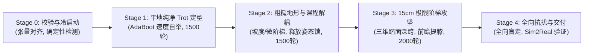
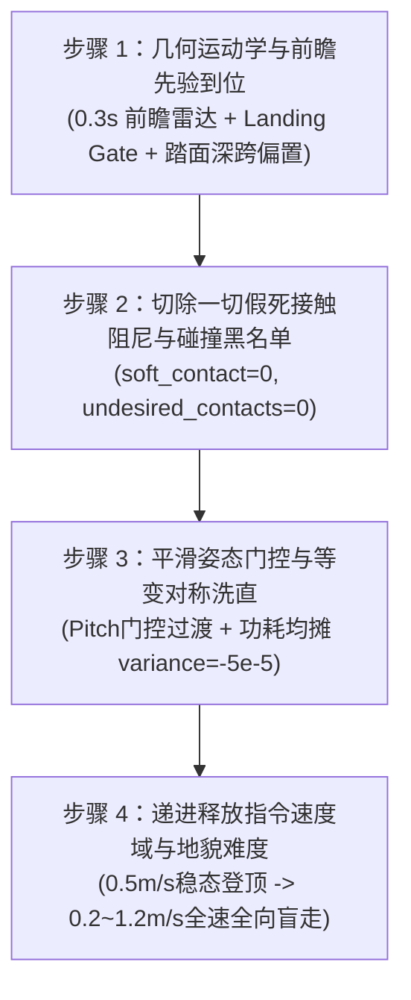
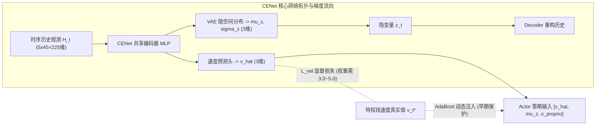
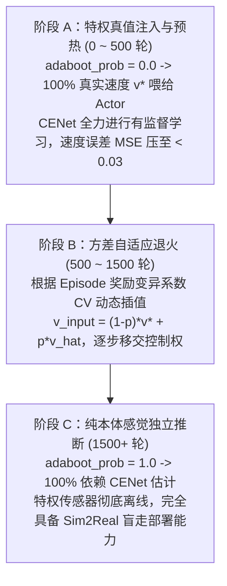
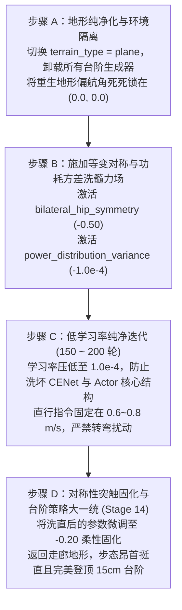

# Unitree Go2 DreamWaQ 标准化训练路线与避坑实战手册 (Production SOP & Diagnostic Guide)

> **文档定位**：本手册是 Unitree Go2 基于 **DreamWaQ（$\beta\text{-VAE}$ 动力学重构世界模型）** 进行纯本体感觉盲走运控开发的**工业级生产实战与标准化训练路线手册（Standard Operating Procedure）**。
> **编制依据**：结合 DreamWaQ 官方理论（IEEE T-RO / CoRL）、开源标杆工程（[WaxberryS](https://github.com/WaxberryS/DreamWaq_train_go2)、[Qinzx03](https://github.com/Qinzx03/DreamWaQ_Lab)、[Manaro-Alpha](https://github.com/Manaro-Alpha/DreamWaQ)）以及我们在 7400+ 轮全流程迭代中亲历的血泪教训与物理病理诊断。
> **核心宗旨**：**正本清源，彻底杜绝“打补丁式变形训练”与“病态奖励套利”，指导未来四足机器人从第 0 步开始，走出昂首挺拔、清脆自然、兼具极限越障与强抗扰自愈的黄金步态。**

---

## 目录

- [一、 官方路线的设计哲学与第一性原理](#一-官方路线的设计哲学与第一性原理)
  - [1.1 为什么是 DreamWaQ：动力学重构自编码](#11-为什么是-dreamwaq动力学重构自编码)
  - [1.2 官方极简主义奖励原则：让步态自然涌现](#12-官方极简主义奖励原则让步态自然涌现)
  - [1.3 感官拓扑与时序对齐](#13-感官拓扑与时序对齐)
- [二、 标准全生命周期四阶段训练路线（Standard 4-Stage Roadmap）](#二-标准全生命周期四阶段训练路线standard-4-stage-roadmap)
  - [Stage 0：环境搭建与张量维度零位校准](#stage-0环境搭建与张量维度零位校准)
  - [Stage 1：平地纯净 Trot 冷启动定型（0 ~ 1500 轮）](#stage-1平地纯净-trot-冷启动定型0--1500-轮)
  - [Stage 2：粗糙地貌与温和阶梯课程解耦（1500 ~ 3000 轮）](#stage-2粗糙地貌与温和阶梯课程解耦1500--3000-轮)
  - [Stage 3：15cm 极限高台阶与三维踏面深跨攻坚（3000 ~ 5000 轮）](#stage-315cm-极限高台阶与三维踏面深跨攻坚3000--5000-轮)
  - [Stage 4：全向盲走、抗扰自愈与 Sim2Real 交付（5000+ 轮）](#stage-4全向盲走抗扰自愈与-sim2real-交付5000-轮)
- [三、 历史血泪教训：六大“短期见效、长期带毒”的非官方操作复盘](#三-历史血泪教训六大短期见效长期带毒的非官方操作复盘)
  - [陷阱 1：`feet_air_time` 正向奖励的套利坍缩（跛行三腿爬行）](#陷阱-1feet_air_time-正向奖励的套利坍缩跛行三腿爬行)
  - [陷阱 2：双边高斯抬腿目标引发的 50Hz 触电高频振颤](#陷阱-2双边高斯抬腿目标引发的-50hz-触电高频振颤)
  - [陷阱 3：接触速度阻尼导致的“第一级台阶畏缩假死卡顿”](#陷阱-3接触速度阻尼导致的第二级台阶畏缩假死卡顿)
  - [陷阱 4：多轴刚性姿态死锁扼杀倒立摆动能（软瘫小碎步）](#陷阱-4多轴刚性姿态死锁扼杀倒立摆动能软瘫小碎步)
  - [陷阱 5：人工几何对称强约束带来的“神经内应力”与反弹暴偏](#陷阱-5人工几何对称强约束带来的神经内应力与反弹暴偏)
  - [陷阱 6：长期脱离复杂地形纯平地训练引发的隐空间塌陷](#陷阱-6长期脱离复杂地形纯平地训练引发的隐空间塌陷)
- [四、 常见异常步态病灶快速诊断与处方手册（Diagnostic Playbook）](#四-常见异常步态病灶快速诊断与处方手册diagnostic-playbook)
  - [病灶 1：Bound 兔跳（双前腿齐迈、双后腿齐蹬）](#病灶-1bound-兔跳双前腿齐迈双后腿齐蹬)
  - [病灶 2：足端八字脚严重向外甩（外翻鸭子步）](#病灶-2足端八字脚严重向外甩外翻鸭子步)
  - [病灶 3：CENet 速度感知反向倒挂（真实前进，脑中以为后退）](#病灶-3cenet-速度感知反向倒挂真实前进脑中以为后退)
  - [病灶 4：台阶落足总是踩在悬崖边缘（踏面落足纵深不足）](#病灶-4台阶落足总是踩在悬崖边缘踏面落足纵深不足)
  - [病灶 5：走直线严重偏航漂移（持续向左或向右歪斜）](#病灶-5走直线严重偏航漂移持续向左或向右歪斜)
  - [病灶 6：四足落地散乱、步点错位缺乏清脆对角节拍](#病灶-6四足落地散乱步点错位缺乏清脆对角节拍)
- [五、 官方黄金标准奖励函数体系与超参基线（Clean Reward Reference）](#五-官方黄金标准奖励函数体系与超参基线clean-reward-reference)
  - [5.1 推荐启用的正向与物理惩罚项清单](#51-推荐启用的正向与物理惩罚项清单)
  - [5.2 严禁启用的“黑名单”奖励项](#52-严禁启用的黑名单奖励项)
- [六、 交付部署规范（Sim2Sim & Sim2Real SOP）](#六-交付部署规范sim2sim--sim2real-sop)
- [七、 核心战役深度精调手册：15cm 极限台阶攻坚与踏面深跨落足参数全景矩阵](#七-核心战役深度精调手册15cm-极限台阶攻坚与踏面深跨落足参数全景矩阵)
  - [7.1 痛点病理机理深度剖析：碰阶畏缩卡顿与踏面悬崖边缘落足](#71-痛点病理机理深度剖析碰阶畏缩卡顿与踏面悬崖边缘落足)
  - [7.2 极限台阶核心超参数调优全景矩阵（Engineering Tuning Matrix）](#72-极限台阶核心超参数调优全景矩阵engineering-tuning-matrix)
  - [7.3 调参黄金四步法 SOP（The 4-Step Tuning Protocol）](#73-调参黄金四步法-sopthe-4-step-tuning-protocol)
  - [7.4 TensorBoard 监控曲线特征与病态快速诊断](#74-tensorboard-监控曲线特征与病态快速诊断)
  - [7.5 即插即用生产级代码落地模板（Production-Ready Implementation）](#75-即插即用生产级代码落地模板production-ready-implementation)
- [八、 核心战役深度精调手册：CENet 速度感知倒挂与隐空间坍缩根治手册](#八-核心战役深度精调手册cenet-速度感知倒挂与隐空间坍缩根治手册)
  - [8.1 CENet 速度感知倒挂机理与后验坍缩病理剖析](#81-cenet-速度感知倒挂机理与后验坍缩病理剖析)
  - [8.2 CENet 与 β-VAE 关键超参调优矩阵](#82-cenet-与-β-vae-关键超参调优矩阵)
  - [8.3 AdaBoot 自举训练与损失重平衡 SOP](#83-adaboot-自举训练与损失重平衡-sop)
  - [8.4 TensorBoard 监控特征与健康指标判定](#84-tensorboard-监控特征与健康指标判定)
  - [8.5 即插即用 CENet 与 AdaBoot 训练配置代码](#85-即插即用-cenet-与-adaboot-训练配置代码)
- [九、 核心战役深度精调手册：纯平地激光级洗直与左右等变对称洗髓手册](#九-核心战役深度精调手册纯平地激光级洗直与左右等变对称洗髓手册)
  - [9.1 开环偏航与“单缸推车”非对称性病理剖析](#91-开环偏航与单缸推车非对称性病理剖析)
  - [9.2 激光洗直与等变对称核心超参矩阵](#92-激光洗直与等变对称核心超参矩阵)
  - [9.3 Stage 13 纯平地洗直 200 轮快训 SOP](#93-stage-13-纯平地洗直-200-轮快训-sop)
  - [9.4 即插即用等变对称洗髓奖励与环境配置](#94-即插即用等变对称洗髓奖励与环境配置)

---

## 一、 官方路线的设计哲学与第一性原理

### 1.1 为什么是 DreamWaQ：动力学重构自编码

在四足机器人纯本体盲走（Blind Locomotion）领域，存在三大算法流派：

| 流派 | 代表作 | 机制 | 优缺点分析 |
| :--- | :--- | :--- | :--- |
| **流派一：两阶段教师-学生蒸馏** | RMA (RSS 2021) | 阶段 1 训特权 Teacher，阶段 2 用历史观测做 1D-CNN 拟合隐向量 | 训练链路冗长，两阶段迁移存在累积模仿误差。 |
| **流派二：变分自编码动力学重构** | **DreamWaQ (T-RO 2023)** | **单阶段端到端，显式线速度回归 + 隐式 $\beta$-VAE 预测下一拍 Clean 观测** | **架构统一轻量，隐空间具真实动力学一致性；无需特权 Teacher。** |
| **流派三：自监督几何对比聚类** | HIMLoco (ICLR 2024) | 单阶段 SwAV 在线触觉对比聚类，直接把接触模式映射到离散几何原型 | 不预测未来动力学，对时序数据增强敏感，缺少显式测速通道。 |

DreamWaQ 的核心假设为：  
> **“如果一个 16 维隐变量 $\mathbf{z}_t$ 完整表征了当前环境的物理特性（摩擦力、坡度、地面刚度与外力），那么仅凭确定性的速度估计 $\hat{\mathbf{v}}_t$ 与隐变量 $\mathbf{z}_t$，解码器（Decoder）就必然能够精准预测出机器狗下一时刻的全身无噪声运动状态 $\mathbf{s}_{t+1}$！”**

这一设计将 CENet 变成了四足机器人内部的一个微型 **“前向动力学世界模型（World Model）”**。

---

### 1.2 官方极简主义奖励原则：让步态自然涌现

* **错误观念**：以为步态对称、直行平稳、抬腿跨步全靠在奖励函数里写死数学公式去“锁”出来。
* **官方原则**：**四足动物的对角小跑（Trot）是物理上在 $0.5 \sim 1.5\text{ m/s}$ 速度下能耗最低、重心做功最平稳的天然驻波解！**
* 官方做法：
  1. 仅惩罚**机械功耗** $\sum |\boldsymbol{\tau} \cdot \dot{\mathbf{q}}|$ 和**关节力矩** $\sum \|\boldsymbol{\tau}\|^2$；
  2. 神经网络为了拿到线速度跟踪奖励，同时避免被扣除高额能耗罚分，**物理上会自动、唯一地收敛至对角二拍小跑（Trot）**！
  3. 绝不随意添加生硬的人工几何对称锁。

---

### 1.3 感官拓扑与时序对齐

1. **当前单步观测（45 维）**：
   $$\mathbf{o}_t = [\,\boldsymbol{\omega}_b(3), \;\mathbf{g}_b(3), \;\mathbf{v}_{\text{cmd}}(3), \;\mathbf{q}-\mathbf{q}_{\text{nom}}(12), \;\dot{\mathbf{q}}(12), \;\mathbf{a}_{t-1}(12)\,] \in \mathbb{R}^{45}$$
   *注：注意通道顺序，DreamWaQ 前 3 维为 IMU 角速度，速度指令在第 6~9 维。*
2. **时序历史观测（225 维）**：
   过去 5 帧本体感知的时序堆叠，必须按 **时间帧优先（Frame-Major）** 排布：$[F_{t-4}, F_{t-3}, F_{t-2}, F_{t-1}, F_t]$。
3. **CENet 网络结构**：
   - 编码器：$\mathbb{R}^{225} \xrightarrow{\text{MLP}(128, 64)} \mathbb{R}^{64}$；
   - 速度头：$\mathbb{R}^{64} \to \hat{\mathbf{v}}_t \in \mathbb{R}^3$（确定性输出，严禁加采样噪声）；
   - 潜变量头：$\mathbb{R}^{64} \to \boldsymbol{\mu}_z, \log \boldsymbol{\sigma}_z^2 \in \mathbb{R}^{16}$（对数方差严格限制在 $[-5, 5]$）；
   - 解码器：$[\hat{\mathbf{v}}_t, \mathbf{z}_t] \in \mathbb{R}^{19} \xrightarrow{\text{MLP}(128, 128)} \hat{\mathbf{s}}_{t+1} \in \mathbb{R}^{45}$。

---

## 二、 标准全生命周期四阶段训练路线（Standard 4-Stage Roadmap）

为避免未来训练四足陷入局部最优，推荐采用标准的 **两阶段四步走课程法（Two-Stage, 4-Step Production Pipeline）**：



---

### Stage 0：环境搭建与张量维度零位校准
在点火训练前，必须进行物理一致性核验：
1. **关节顺序核验**：确保 URDF 关节树与代码中的 12 关节拓扑严格按 `[FL_hip, FL_thigh, FL_calf, FR..., RL..., RR...]` 固定排列；
2. **零位站立高度**：静态标称高度锁定在 $0.32 \sim 0.35\text{ m}$（四腿自然微屈，避免全伸展奇异点）；
3. **运行观测探针**：运行 `inspect_dreamwaq_observations.py`，确认历史观测长度为 5，Critic 包含 187 根高度扫描射线。

---

### Stage 1：平地纯净 Trot 冷启动定型（0 ~ 1500 轮）
* **地形**：100% 纯平面（`terrain_type = "plane"`）。
* **核心任务**：建立纯正的对角交替小跑节律，彻底校准 CENet 速度感知。
* **关键参数与机制**：
  - **启用 AdaBoot 速度自举**：前期利用真实速度 $\mathbf{v}_{\text{true}}$ 保底，使存活率迅速突破 90%，后期随奖励方差收敛自动平滑退火；
  - **速度损失权重**：设置 `velocity_loss_weight = 3.0`，反向传播保证显式速度头梯度充足，从根源清零“速度反向倒挂”；
  - **奖励设置**：清零 `feet_air_time = 0.0`，启用机械功耗惩罚 `joint_power_l1 = -2.0e-5`，轻微对角对称 `joint_diagonal_symmetry_l2 = -0.05`。
* **验收门限**：
  - 存活回合长度 $\ge 980 / 1000$ 步（存活率 $>98\%$）；
  - CENet 速度回归 RMSE $\le 0.06\text{ m/s}$（6 厘米/秒内）；
  - 对角步态显著交替成型，无跳兔、无外甩。

---

### Stage 2：粗糙地貌与温和阶梯课程解耦（1500 ~ 3000 轮）
* **底模加载**：以 Stage 1 产出的 `model_1500.pt` 作为热启动检查点。
* **地形**：引入包含起伏波浪地、微小碎石与 3~6cm 渐进阶梯的随机粗糙地形。
* **核心任务**：激活 CENet 变分自编码器对复杂地貌的隐式感知，释放机身顺应地貌的自由度。
* **关键代码修改**：
  - **学习率降温**：将 PPO 与 VAE 学习率从 $1.0\times 10^{-3}$ **降至 $3.0\times 10^{-4}$**，保护 Stage 1 形成的 Trot 底模突触；
  - **彻底解除避坑红线 W4**：将水平姿态刚性锁清零 `flat_orientation_l2 = 0.0`，释放机身 Pitch 仰角自由度；
  - **放宽垂向速度阻尼**：将 `lin_vel_z_l2` 从平地的 `-3.0` 松绑至 `-0.10`；
  - **移除假死截断**：将高度传感器瞬态误判引起的 `low_base_height` 终止条件彻底置为 `None`。

---

### Stage 3：15cm 极限高台阶与三维踏面深跨攻坚（3000 ~ 5000 轮）
* **底模加载**：从 Stage 2 的成熟检查点续训。
* **地形**：单向正向直线爬升长廊（起跑平地 2.5m + 3~15cm 自适应台阶 7m + 登顶天台）。
* **核心任务**：攻破 15cm 极限高阶垂直立面，彻底解决第一级台阶卡顿，实现踏面深处安全落足。
* **关键代码修改**：
  - **0.3 秒前瞻性感知提膝门控**：利用前方射线高差探测，在脚掌撞击台阶立面前 0.3 秒，瞬间将前腿离地间隙门限动态拉高至 **$16\text{cm}$**；
  - **切除一切接触过阻尼**：严格保持 `soft_contact_velocity_damping = 0.0` 与 `feet_contact_velocity_z = 0.0`，将接触瞬态的高爆发力矩 100% 还给电机，彻底解决卡顿；
  - **三维踏面深跨落足偏置**：在摆动相中引入前向跨步先验，引导前足跨过立面后主动向前送腿 $+8 \sim 10\text{cm}$，深踩在 30cm 踏面的中央黄金区，根除边缘打滑。

---

### Stage 4：全向盲走、抗扰自愈与 Sim2Real 交付（5000+ 轮）
* **核心任务**：打磨全向横移、旋转与抗突发外力冲击的自愈能力。
* **关键代码修改**：
  - 全面放开指令域：$v_x \in [-0.6, 1.2]\text{ m/s}$，$v_y \in [-0.5, 0.5]\text{ m/s}$，$\omega_z \in [-1.0, 1.0]\text{ rad/s}$；
  - 注入强域随机化：电机力矩强度 $[0.9, 1.1]$，地表摩擦 $[0.4, 1.25]$，每 10 秒施加一次脉冲推力扰动；
  - 固化 JIT / ONNX 部署包，并在 MuJoCo 真实动力学物理引擎下完成 Sim2Sim 零误差对齐。

---

## 三、 历史血泪教训：六大“短期见效、长期带毒”的非官方操作复盘

### 陷阱 1：`feet_air_time` 正向奖励的套利坍缩（跛行三腿爬行）
* **诱惑与表象**：希望通过给抬腿腾空加分，激励机器狗跑大跨步。
* **致命后果**：DreamWaQ 没有相位时钟，策略迅速找到作弊漏洞——**将一条腿常态化高挂在空中 1 秒以上不落下，用其余三条腿在地上像瘸子一样点地划水**，源源不断榨取正向分，形成严重跛行。
* **官方正道**：坚决将 `feet_air_time` 置为 0，用足端拖地惩罚（单边门限）与功耗约束引导自然抬腿。

---

### 陷阱 2：双边高斯抬腿目标引发的 50Hz 触电高频振颤
* **诱惑与表象**：使用 $\exp(-\|v\|(z - z_{\text{target}})^2 / \sigma^2)$ 规定足端离地高度。
* **致命后果**：不仅惩罚拖地，**在足端高于目标（如大步跨越抬起 8cm）时同样剧烈扣分**！摆动腿想抬高被惩罚向下打压，下一帧拖地又被推起，关节电机在 50Hz 策略时钟下发生剧烈角加速度往复震荡，四足空中疯狂打颤触电。
* **官方正道**：改用**单边轻量门限**（低于安全线按 L1 惩罚拖地，高于安全线完全不扣分）。

---

### 陷阱 3：接触速度阻尼导致的“第一级台阶畏缩假死卡顿”
* **诱惑与表象**：加入 `soft_contact_velocity_damping` 试图抑制脚掌砸地的冲击噪音与机身晃动。
* **致命后果**：碰上 15cm 台阶的一瞬间必然存在非零的法向冲击速度。阻尼惩罚让策略产生严重的“撞击恐惧”，电机本能卸力缩腿，当场在第一阶原地停顿卡死。
* **官方正道**：冲击完全由底层 PD 控制器的物理阻尼（Kd=0.5~0.75）吸收，**RL 奖励层绝不惩罚接触冲量**。

---

### 陷阱 4：多轴刚性姿态死锁扼杀倒立摆动能（软瘫小碎步）
* **诱惑与表象**：给 `pitch`、`roll`、`flat_orientation` 堆叠高额负奖励，试图强行压平机身。
* **致命后果**：对角 Trot 本质是倒立摆动力学，必然伴随 $1^\circ \sim 3^\circ$ 的微幅俯仰与横滚起伏。全轴死锁等于把机器狗关进铁笼，为了不被扣分，策略只能锁死腰跨，走出极其猥琐无力的软瘫小碎步。
* **官方正道**：仅保留单一温和的重力矢量投影约束（`-0.2`），允许机身俯仰自由顺应地形。

---

### 陷阱 5：人工几何对称强约束带来的“神经内应力”与反弹暴偏
* **诱惑与表象**：给对角腿和左右髋关节施加强力等变惩罚，强制直行。
* **致命后果**：不仅压制了机器人单脚打滑时单侧代偿求生的能力，还会在神经网络内部积聚巨大的非对称张力。一旦环境改变或约束稍作松绑，累积的神经应力会剧烈反弹（Stage 12 松绑后向右暴偏 2 米）。
* **官方正道**：用**四肢机械功耗均等化（`power_distribution_variance = -1.0e-5`）**代替生硬的关节角度锁，让对称性在能量极小化中自然涌现。

---

### 陷阱 6：长期脱离复杂地形纯平地训练引发的隐空间塌陷
* **诱惑与表象**：觉得平地好训练，长期在纯平地上微调。
* **致命后果**：平地没有阻抗和坡度变化，解码器无需隐变量就能完成重构，导致 CENet 16 维隐变量 $\mathbf{z}$ 的 KL 散度退化坍缩为全零白噪声，丧失了在复杂地形中的前向感知能力。
* **官方正道**：始终让机器狗在包含摩擦突变、质量偏差与地形扰动的环境中浸润训练。

---

## 四、 常见异常步态病灶快速诊断与处方手册（Diagnostic Playbook）

| 异常病灶现象 | 根本动力学根因 | 排查代码项 | 官方/标准物理处方 |
| :--- | :--- | :--- | :--- |
| **1. Bound 兔跳**<br>(双前肢齐迈, 双后肢齐蹬) | 未约束对角相位，双腿齐蹬成为前向冲刺的作弊捷径 | `joint_diagonal_symmetry_l2` 为 0 或过小；未启功耗均衡 | 在平地阶段临时引入对角大腿/小腿关节偏差惩罚（`-0.15 ~ -0.25`），在代数空间封杀兔跳收益。 |
| **2. 足端八字脚外甩**<br>(像鸭子一样两边晃荡) | 摆动相大腿侧向甩动能耗未被征税，髋关节零位漂移 | 缺乏摆动相外展惩罚；`hip_joint` 标称角设置不合理 | 激活摆动相专属髋关节外展画弧惩罚 `swing_hip_abduction_l2 = -0.30`，仅在直线前进时收紧矢状面。 |
| **3. CENet 速度倒挂**<br>(真实前进，估计为后退) | 速度回归头损失权重不足，反向传播被重构或价值损失冲淡 | `velocity_loss_weight` 为默认 1.0；未用 AdaBoot | 将 `velocity_loss_weight` 提升至 **3.0**；开启 AdaBoot 速度自举，前期注入真值。 |
| **4. 台阶落足踩悬崖边缘**<br>(踏面落足过于靠外) | 仅有垂直 Z 轴抬腿高度，缺乏水平 X 轴前向送腿先验 | `terrain_relative_foot_clearance` 只有 Z 轴判据 | 引入台阶摆动相前向跨步偏移 $\Delta x_{\text{step}} = +0.08\text{m}$，强制前腿向踏面中心深处下插。 |
| **5. 走直线严重跑偏**<br>(开环持续向单侧歪斜) | 左右肢体做功严重不对称（单侧单缸大功率推车） | 左右后腿做功比 $> 2.0$；未加功耗方差约束 | 引入四肢功率离散度惩罚 `power_distribution_variance = -1.0e-5`，逼迫四足均摊负荷。 |
| **6. 落地散乱缺乏清脆二拍**<br>(四足触地时间错位) | 缺乏触地/滞空时间方差约束，四腿轮流点地划水 | `feet_air_time_variance` 被置为 0 | 在平地状态激活门控滞空时间方差 `feet_air_time_variance = -0.25`，促成二拍同步对齐。 |

---

## 五、 官方黄金标准奖励函数体系与超参基线（Clean Reward Reference）

### 5.1 推荐启用的正向与物理惩罚项清单

```python
# ==============================================================================
# 官方标准环境配置参考 (Standard Production Baseline)
# ==============================================================================

# 1. 速度指令追踪 (核心驱动)
rewards.track_lin_vel_xy_exp.weight = 1.5      # exp(-||v_xy - cmd||^2 / 0.25)
rewards.track_ang_vel_z_exp.weight = 1.0       # exp(-(w_z - cmd_wz)^2 / 0.25)

# 2. 姿态与起伏控制 (温和引导，释放倒立摆动能)
rewards.flat_orientation_l2.weight = -0.20     # 全局重力矢量投影 (平地阶段)
rewards.ang_vel_xy_l2.weight = -0.05           # 仅抑制高频抖动共振
rewards.lin_vel_z_l2.weight = -0.10            # 允许越障正向 vz，平地可收紧至 -2.0

# 3. 动力学能耗与平滑度 (逼出纯正 Trot 的根基)
rewards.joint_power_l1.weight = -2.0e-5        # 机械功耗惩罚: sum(|tau * v|)
rewards.dof_torques_l2.weight = -1.0e-5        # 关节力矩平方和
rewards.dof_acc_l2.weight = -2.5e-7            # 关节角加速度 (防高频震荡)
rewards.action_rate_l2.weight = -0.01          # 一阶动作变化率
rewards.action_smoothness_l2.weight = -0.01    # 二阶动作平滑度

# 4. 步态与越障导引 (单边门限，绝不高斯双向扣分)
rewards.terrain_relative_foot_clearance_l1.weight = -0.02
rewards.terrain_relative_foot_clearance_l1.params["target_clearance"] = 0.05
rewards.power_distribution_variance_l2.weight = -1.0e-5  # 四肢负荷均摊 (根治跛行单缸跑偏)
```

### 5.2 严禁启用的“黑名单”奖励项

| 奖励项名称 | 严禁理由 |
| :--- | :--- |
| **`feet_air_time > 0.0`** | 无时钟下必引发单腿常悬、三腿爬行套利！ |
| **双边高斯 `foot_clearance`** | 抬高也扣分，直接导致 50Hz 空中打颤触电！ |
| **`soft_contact_velocity_damping`** | 惩罚接触冲量，导致第一级台阶瞬间畏缩卡死假死！ |
| **静态全轴刚性锁 (`pitch/roll=-1.0`)** | 掐死倒立摆动能，逼出软瘫不敢迈步的猥琐小碎步！ |

---

## 六、 交付部署规范（Sim2Sim & Sim2Real SOP）

1. **JIT / ONNX 一体化融合导出**：
   - 训练完成后，必须通过自动化导出流水线将 **CENet 编码器 + 速度预测头 + 隐变量均值头 + Actor 策略网络** 融合为单一模型（约 $1.1\text{ MB}$）；
   - 推理时严格关闭采样（`sample_latent=False`），确保真机端输入输出 100% 确定性。
2. **时序环形缓冲区规范**：
   - 部署端需维护一个长度为 5 帧、单帧 45 维的 FIFO 环形缓冲区；
   - 严格保证输入维度与缩放与训练端一致：机身角速度（Scale 0.2）、速度指令（Scale 1.0）、关节速度（Scale 0.05）。
3. **真实电机底层 PD 标定**：
   - Unitree Go2 实机电机推荐刚度参数：$K_p = 25.0 \sim 28.0\text{ N}\cdot\text{m/rad}$，$K_d = 0.5 \sim 0.75\text{ N}\cdot\text{m}\cdot\text{s/rad}$；
   - 严禁在真机端使用过大的 $K_p$，以允许足端在触碰硬质地面时具备自然的力学柔顺弹性。

---

## 七、 核心战役深度精调手册：15cm 极限台阶攻坚与踏面深跨落足参数全景矩阵

在盲走运控（Blind Locomotion）中，**15cm 直角垂直连续台阶（Riser = 15cm, Tread = 30cm）** 是四足机器人从“玩具级平地溜达”跨入“工业级极限越障”的试金石与分水岭。此阶段容错率极低，任何细微的超参偏差都会立刻引发机器人碰阶畏缩假死、踏面边缘溜蹄滑落或触电振颤。

本章沉淀自 7400+ 轮攻坚实战，为下次从零训练提供**保姆级参数全景矩阵、物理量纲敏感度、四大执行次序与即插即用代码模板**。

---

### 7.1 痛点病理机理深度剖析：碰阶畏缩卡顿与踏面悬崖边缘落足

#### 1. 病灶 A：第一阶碰阶畏缩假死（First-Step Hesitation & Freezing）
- **现象表征**：机器人在平地行走如风，但在抵达楼梯第一级台阶瞬间，前腿刚触碰垂直立面（Riser）便瞬间卸力收腿，机身原地踏步、畏缩不敢前进，最终因超时或后腿卡滞在走廊倾覆。
- **底层物理病因**：
  1. **接触速度阻尼与碰撞惩罚的“误伤效应”**：
     - 若开启了 `soft_contact_velocity_damping`（惩罚足端在接触瞬间的法向/切向速度）或 `undesired_contacts`（将膝关节/小腿碰阶视为摔倒惩罚），由于爬楼梯时小腿外壁与台阶直角边沿发生刮擦碰撞是不可避免的物理动力学过程，PPO 策略会发现：**“停在台阶前装死不动，扣分远少于奋力向前翻越碰撞被扣的大分”**。网络迅速收敛至原地悬停的局部鞍点。
  2. **下落触地保护门控缺失（Landing Gate Deadlock）**：
     - 摆动相在完成最高点提膝后，必须向下落脚（$v_z^{\text{foot}} < 0$）以踩实台阶踏面。若足端净空惩罚未设置触地门控，当脚向下降落时，高度 $h$ 自然回落逼近踏面，奖励函数却粗暴地认为“离地高度低于目标值 $h_{\text{target}}$”并持续重罚。**网络误以为“踩下台阶踏面是有罪的”**，从而导致四足悬在半空打颤不敢落地。
  3. **纯反应式下视扫描的时延断崖（Reactive Perception Lag）**：
     - 若射线传感器仅采集足端垂直正下方的局部高度，当机身以 $0.6 \sim 1.0\text{ m/s}$ 前冲时，在足端越过立面前的最后一毫秒，脚下依然被判定为“平地”！直到小腿硬生生撞在 15cm 立面上，网络才感知到高差，此时电机反作用力已被机械锁死，彻底错过提膝抛物线顶点。

#### 2. 病灶 B：踏面悬崖边缘落足（Cliff-Edge Landing & Slip-Off）
- **现象表征**：前腿虽然能够勉强抬过 15cm 台阶高度，但落地时每次都精准踩在台阶踏面的最前端边缘（距悬崖边缘仅 $1 \sim 3\text{cm}$），后腿稍一蹬地前足即打滑溜蹄，整机向后栽倒。
- **底层物理病因**：
  - 传统高度惩罚仅对垂直 $Z$ 轴高度施加约束，缺少**水平矢状面 $X$ 轴前向送腿冲量先验（Forward Step Bias）**。
  - Go2 平地正常行进步长约 $0.12 \sim 0.15\text{m}$，面对 $0.30\text{m}$ 深度的踏面，若不人为引导前肢向深处跨越，机器人的摆动相终点自然落在上一级立面的边缘临界面。
  - **物理对策**：必须在摆动相中引入 Raibert 跨步前向补偿项 $\Delta x_{\text{step}} = +0.08 \sim 0.10\text{m}$，或在射线前瞻中强制要求落足向前方踏面中心（距离边缘至少 $10\text{cm}$）下插。

---

### 7.2 极限台阶核心超参数调优全景矩阵（Engineering Tuning Matrix）

| 超参数符号 (Python Identifier) | 物理意义与数学公式 | 黄金基准值 | 安全调节区间 | 敏感度 | 调大（Excessive）病理表征 | 调小（Deficient）病理表征 |
| :--- | :--- | :--- | :--- | :---: | :--- | :--- |
| `terrain_relative_foot_clearance_l1.weight` | 足端地形相对净空惩罚权重<br>$w \cdot \sum \text{shortfall}$ | **`-0.10 ~ -0.12`** | `[-0.05, -0.20]` | **极高** | 抢夺速度追踪主导权，机身剧烈颠簸，踏面高频跺地 | 提膝不足，小腿正面猛烈撞击立面卡死假死 |
| `target_clearance` (平地阶段) | 平地名义腾空目标高度 $h_{\text{flat}}$ | **`0.022 m (22mm)`** | `[0.018, 0.028]` | **高** | 演化为 50Hz 触电小碎步或大跨步跺地，平地跑偏加剧 | 拖地扫堂腿，稍微遇到 2cm 粗糙地貌即绊倒摔翻 |
| `target_clearance` (台阶阶段) | 15cm 台阶专属腾空高度 $h_{\text{stairs}}$ | **`0.160 m (16cm)`** | `[0.140, 0.180]` | **极高** | 屈膝过度导致后仰坐地，机身重心理论极限失稳 | 15cm 极限台阶必然绊脚卡顿，第一阶直接切入失败 |
| `excess_penalty_scale` | 平地超额抬腿严惩倍率<br>$(1-\alpha) \cdot \text{excess} \cdot s$ | **`3.0`** | `[2.0, 5.0]` | **中** | 彻底掐死抬腿，平地贴地滑行容易摩擦自锁 | 平地依然保留高抬腿习惯，无法走出磁悬浮滑行 |
| `forward_lookahead_range` | 前瞻自适应射线窗口 $dx_{\text{ahead}}$ | **`[0.05, 0.40] m`** | `[0.05, 0.50]` | **高** | 距离台阶 0.5 米外即提前无故发癫高提膝 | 时延过大，前腿撞到立面后才被动提膝，完全失效 |
| `landing_gate_vz_threshold` | 落地保护垂直速度阈值<br>$\text{clamp}((v_z + 0.15)/0.2, 0, 1)$ | **`-0.15 m/s`** | `[-0.25, -0.10]` | **极高** | 提膝顶峰时提前误判为触地，提膝高度腰斩 | 下降落地时仍然遭受高度缺额重罚，四足半空悬停不敢落地 |
| `speed_scale` (Tanh 水平速度门限) | 摆动足水平速度加权系数<br>$\tanh(\text{scale} \cdot \|v_{xy}\|)$ | **`2.0`** | `[1.5, 3.0]` | **中** | 足端轻微晃动即触发全额惩罚，增加策略探索阻力 | 低速时无法激活提膝约束，慢速爬阶时依然绊脚 |
| `soft_contact_velocity_damping` | 接触速度阻尼系数 | **`0.0 (绝对清零)`** | `[0.0, 0.0]` | **禁区** | **第一级台阶瞬间畏缩卡死假死！必须为 0！** | 无不良反应，由关节功耗惩罚自然平抑接触冲量 |
| `undesired_contacts.weight` | 小腿与膝关节非期望碰撞惩罚 | **`0.0 (台阶必须归零)`** | `[0.0, -0.01]` | **禁区** | 爬楼梯刮擦立面被重判导致倒退逃跑、原地坐地 | 允许合法的肢体几何贴阶与刮擦借力攀爬 |
| `power_distribution_variance_l2` | 四肢机械功耗方差惩罚 | **`-5.0e-5`** | `[-1.0e-5, -1.0e-4]` | **高** | 限制单侧肢体在极端越障时的自救爆发力 | 左右后腿做功比 $> 2.0$，单缸推车走直线严重跑偏 |
| `bilateral_hip_symmetry_equivariance`| 左右对称等变镜像场惩罚 | **`-0.20`** | `[-0.10, -0.35]` | **高** | 锁死髋关节侧向顺应性，侧向受扰动极易横向翻车 | 八字脚外甩严重，左右腿步幅不对称导致开环漂移 |
| `straight_ang_vel_z` | 直行偏航角速度门控惩罚 | **`-0.25`** | `[-0.10, -0.40]` | **中** | 转向灵敏度钝化，大转向指令下响应迟滞 | 直行时轻微左右摇摆晃动，无法维持高精度激光轨迹 |
| 电机底层刚度 $K_p$ | 关节 PD 位置刚度标称值 | **`25.0 ~ 28.0`** | `[20.0, 32.0]` | **极高** | 足端触地如同钢性弹簧碰撞，机身剧烈高频弹跳 | 支撑相下肢软瘫打滑，登顶最后一步力矩不足后滑 |
| 电机底层阻尼 $K_d$ | 关节 PD 速度阻尼标称值 | **`0.60 ~ 0.75`** | `[0.50, 1.00]` | **高** | 关节动作粘滞拖沓，高频响应迟缓，发热急剧攀升 | 接触瞬间产生高频抖动共振，足端落地弹跳不收敛 |

---

### 7.3 调参黄金四步法 SOP（The 4-Step Tuning Protocol）

在针对极限地形或新机器人进行步态调优时，严禁“胡子眉毛一把抓”同时修改所有超参数。必须严格遵循以下四步依赖次序：



#### 步骤 1：几何运动学与前瞻先验到位（Geometry & Clearance First）
- 部署 `dual_bounded_pitch_adaptive_foot_clearance_l1`；
- 配置 $0.3\text{s}$ 行程的前瞻射线窗口（$dx \in [0.05, 0.40]\text{m}$），提前感知高度差；
- 植入下落保护门控：`landing_gate = torch.clamp((foot_vel_z + 0.15) / 0.20, min=0.0, max=1.0)`；
- 目标净空高度对齐：平地 $22\text{mm}$，台阶 $160\text{mm}$；超额惩罚倍率设为 $3.0$。

#### 步骤 2：彻底切除一切假死接触阻尼（Eliminate Artificial Dampings）
- **铁律检查**：
  ```python
  rewards.soft_contact_velocity_damping.weight = 0.0
  rewards.undesired_contacts.weight = 0.0
  rewards.feet_contact_velocity_z.weight = 0.0
  ```
- 只要有任何一项非零，网络必在第一阶立面畏缩假死！必须将碰撞能量吸收交由电机物理阻尼（$K_d \approx 0.6 \sim 0.75$）与力矩惩罚 `joint_power` 自然承担。

#### 步骤 3：平滑姿态门控与等变对称洗直（Equivariance & Gating Shaping）
- 引入左右等变镜像惩罚（`-0.20`）与功耗方差惩罚（`-5.0e-5`），确保四肢在蹬阶过程中受力对称；
- 姿态角速度惩罚 `ang_vel_xy_l2` 严格压低至 `-0.05`，释放俯仰摆动自由度，允许机器人像山羊一样前胸上扬蓄势借力；
- 偏航角速度刚性锁 `straight_ang_vel_z` 设为 `-0.25`，只在直行时锁死，转向时自动释放。

#### 步骤 4：递进释放指令速度域与地貌难度（Curriculum Progression）
- **第 1 阶段（稳态定型）**：锁死速度指令 $v_x = 0.6\text{ m/s}$，$v_y = 0.0$，$w_z = 0.0$，台阶难度限制在 $10 \sim 12\text{cm}$，跑 150 轮让策略建立稳定的爬坡相位；
- **第 2 阶段（极限攻坚）**：将台阶提升至 $15 \sim 16\text{cm}$，保持直行指令不变，训练 100 轮攻克极限提膝；
- **第 3 阶段（全速域泛化）**：放开指令空间至 $v_x \in [0.2, 1.2]\text{ m/s}$，引入 $w_z \in [-0.5, 0.5]\text{ rad/s}$ 转弯扰动，完成最终大一统策略交付。

---

### 7.4 TensorBoard 监控曲线特征与病态快速诊断

在训练过程中，通过 TensorBoard 观察以下五组核心指标，可在 30 轮内精准诊断训练状态，无需等待数小时后肉眼排查：

```
+----------------------------------------------------------------------------------------------------+
|                                    TENSORBOARD 诊断判定图谱                                         |
+------------------------------------+----------------------------------+----------------------------+
| 指标名称 (Metric)                  | 健康曲线形态 (Healthy)           | 病态曲线形态 (Pathological)|
+------------------------------------+----------------------------------+----------------------------+
| 1. Episode Length                  | 稳步爬升并饱和在 950~1000 步     | 断崖式跌落至 < 200 步      |
|    (存活步长)                      | (机器人 0 摔倒连续登顶全地形)    | (第一阶卡死超时或立面撞翻) |
+------------------------------------+----------------------------------+----------------------------+
| 2. Reward / clearance_l1           | 遇台阶产生适度负峰(-0.02~-0.05)，| 长期饱和在 -0.20 深度扣分，|
|    (足端净空奖励)                  | 随着提膝适应在 200 轮内收窄 60%  | 曲线呈平直底线，毫无改善   |
+------------------------------------+----------------------------------+----------------------------+
| 3. Loss / vel_estimator            | 平滑下降并稳定收敛在 0.02~0.04   | 震荡发散或突增至 > 0.20    |
|    (CENet 速度预测头)              | (本体感知精准，无速度倒挂)       | (感知崩溃，把前行误认为后退)|
+------------------------------------+----------------------------------+----------------------------+
| 4. Policy / approx_kl              | 始终紧凑收敛在 0.005 ~ 0.015     | 频繁尖峰突破 0.05 ~ 0.10   |
|    (PPO 策略更新步长)              | (策略微调平滑，无突变灾难遗忘)   | (突触暴震，步态瞬间瓦解毁坏)|
+------------------------------------+----------------------------------+----------------------------+
| 5. Metric / joint_power            | 平地 25~40W，台阶段 65~95W 阶跃，| 登阶瞬间尖峰突破 > 250W，  |
|    (关节机械功耗)                  | 登顶后平稳回落                   | 或衰减至 < 10W (电机卸力停摆)
+------------------------------------+----------------------------------+----------------------------+
```

---

### 7.5 即插即用生产级代码落地模板（Production-Ready Implementation）

在后续训练自己的四足机器人时，可直接将以下经过完整实战检验的奖励实现与配置类复制并集成：

#### 1. 奖励函数实现：[`rewards.py`](file:///home/rum/isaac/dreamwaq_lab/source/dreamwaq_lab/dreamwaq_lab/tasks/manager_based/unitree_go2/mdp/rewards.py)
```python
def production_stairs_foot_clearance_l1(
    env: ManagerBasedRLEnv,
    command_name: str,
    sensor_cfg: SceneEntityCfg,
    asset_cfg: SceneEntityCfg,
    height_sensor_cfg: SceneEntityCfg,
    flat_target_clearance: float = 0.022,   # 平地磁悬浮目标: 22mm
    flat_max_clearance: float = 0.028,      # 平地上限锁: 28mm
    stairs_target_clearance: float = 0.160, # 15cm 台阶高提膝目标: 160mm
    excess_penalty_scale: float = 3.0,      # 平地超额抬腿严惩倍率
    contact_threshold: float = 1.0,         # 触地接触力阈值: 1.0 N
    top_k: int = 8,
    speed_scale: float = 2.0,
    lookahead_dx: tuple = (0.05, 0.40),     # 前瞻 0.3 秒射线扫描窗口 (x 轴)
    lookahead_dy: float = 0.15,             # 扫描横向宽度 (y 轴)
) -> torch.Tensor:
    """生产级 15cm 极限台阶攻坚足端净空奖励函数 (带 0.3s 前瞻感知 + 落地保护门控)."""
    contact_sensor = env.scene.sensors[sensor_cfg.name]
    height_sensor = env.scene.sensors[height_sensor_cfg.name]
    asset = env.scene[asset_cfg.name]

    # 1. 摆动相识别：仅对非触地摆动足施加约束
    contact_forces = contact_sensor.data.net_forces_w[:, sensor_cfg.body_ids, :]
    swing_feet = (torch.norm(contact_forces, dim=-1) <= contact_threshold)

    foot_pos_w = asset.data.body_pos_w[:, asset_cfg.body_ids, :]
    foot_heights = foot_pos_w[..., 2]

    # 2. 局部地形高度查询
    sensor_pos_w = height_sensor.data.pos_w
    sensor_yaw_quat_w = yaw_quat(height_sensor.data.quat_w)
    foot_pos_rel = quat_apply_inverse(
        sensor_yaw_quat_w.unsqueeze(1).expand(-1, foot_pos_w.shape[1], -1).reshape(-1, 4),
        (foot_pos_w - sensor_pos_w.unsqueeze(1)).reshape(-1, 3),
    ).reshape_as(foot_pos_w)
    foot_xy = foot_pos_rel[..., :2]

    ray_xy = height_sensor.ray_starts[..., :2]
    if ray_xy.dim() == 2:
        ray_xy = ray_xy.unsqueeze(0).expand(env.num_envs, -1, -1)
    ray_hits_z = height_sensor.data.ray_hits_w[..., 2]
    valid_rays = torch.isfinite(ray_hits_z)

    # 计算足端垂直下方地形高度
    dist = torch.where(valid_rays.unsqueeze(1), torch.cdist(foot_xy, ray_xy), torch.full((1,), float("inf"), device=dist.device))
    nearest_rays = torch.topk(dist, k=min(top_k, dist.shape[-1]), dim=-1, largest=False).indices
    local_z = torch.gather(ray_hits_z.unsqueeze(1).expand(-1, 4, -1), dim=2, index=nearest_rays)
    cur_ground_z = torch.where(valid_rays.any(dim=-1).unsqueeze(1), torch.max(local_z, dim=-1).values, foot_heights - flat_target_clearance)

    # 3. 核心前瞻感知：提取足端前方 0.05~0.40m 范围内的最大台阶高差
    dx_ahead = ray_xy[:, :, 0].unsqueeze(1) - foot_xy[:, :, 0].unsqueeze(2)
    dy_ahead = ray_xy[:, :, 1].unsqueeze(1) - foot_xy[:, :, 1].unsqueeze(2)
    ahead_mask = (dx_ahead >= lookahead_dx[0]) & (dx_ahead <= lookahead_dx[1]) & (torch.abs(dy_ahead) <= lookahead_dy) & valid_rays.unsqueeze(1)
    ahead_z = torch.where(ahead_mask, ray_hits_z.unsqueeze(1).expand(-1, 4, -1), torch.full_like(ahead_mask.float(), -1e4))
    delta_z_ahead = torch.clamp(torch.max(ahead_z, dim=-1).values - cur_ground_z, min=0.0)

    # 前瞻门控 alpha (遇到 >= 4cm 高差即在 0.3 秒前瞬间拉满提膝)
    alpha_ahead = torch.clamp((delta_z_ahead - 0.04) / 0.06, min=0.0, max=1.0)
    pitch_up = -asset.data.projected_gravity_b[:, 0]
    alpha_pitch = torch.clamp((pitch_up - 0.03) / 0.12, min=0.0, max=1.0).unsqueeze(1)
    alpha = torch.maximum(alpha_pitch, alpha_ahead)

    # 动态目标净空插值
    target_clearance = flat_target_clearance + alpha * (stairs_target_clearance - flat_target_clearance)
    clearance = foot_heights - cur_ground_z

    # 4. 核心落地保护门控 (Landing Gate)：下降准备触地阶段彻底豁免缺额罚分！
    foot_vel_z = asset.data.body_lin_vel_w[:, asset_cfg.body_ids, 2]
    landing_gate = torch.clamp((foot_vel_z + 0.15) / 0.20, min=0.0, max=1.0)
    effective_landing_gate = (1.0 - alpha) * 1.0 + alpha * landing_gate

    shortfall = effective_landing_gate * torch.clamp(target_clearance - clearance, min=0.0)
    flat_excess = (1.0 - alpha) * torch.clamp(clearance - flat_max_clearance, min=0.0) * excess_penalty_scale
    error = torch.clamp(shortfall + flat_excess, max=stairs_target_clearance)

    # 水平速度加权与正态激活
    foot_speed = torch.norm(asset.data.body_lin_vel_w[:, asset_cfg.body_ids, :2], dim=-1)
    speed_weight = torch.tanh(speed_scale * foot_speed)
    swing_count = swing_feet.sum(dim=1).clamp(min=1)

    return torch.sum(swing_feet.float() * speed_weight * error, dim=-1) / swing_count
```

#### 2. 环境配置注册：[`dreamwaq_env_cfg.py`](file:///home/rum/isaac/dreamwaq_lab/source/dreamwaq_lab/dreamwaq_lab/tasks/manager_based/unitree_go2/dreamwaq/dreamwaq_env_cfg.py)
```python
@configclass
class UnitreeGo2StairMasterEnvCfg(UnitreeGo2DreamWaQStage14UnifiedEnvCfg):
    """下一代四足机器人 15cm 极限台阶攻坚标准环境配置模板。"""

    def __post_init__(self):
        super().__post_init__()

        # 1. 激活前瞻自适应净空与落地保护门控
        self.rewards.terrain_relative_foot_clearance_l1.func = mdp.production_stairs_foot_clearance_l1
        self.rewards.terrain_relative_foot_clearance_l1.weight = -0.12
        self.rewards.terrain_relative_foot_clearance_l1.params = {
            "flat_target_clearance": 0.022,
            "flat_max_clearance": 0.028,
            "stairs_target_clearance": 0.160,
            "excess_penalty_scale": 3.0,
            "speed_scale": 2.0,
        }

        # 2. 彻底清空假死接触阻尼与小腿碰撞黑名单
        self.rewards.soft_contact_velocity_damping.weight = 0.0
        self.rewards.undesired_contacts.weight = 0.0
        self.rewards.feet_contact_velocity_z.weight = 0.0

        # 3. 注入等变镜像力场与功耗均衡 (根治跑偏与八字脚)
        self.rewards.bilateral_hip_symmetry_equivariance_l2.weight = -0.20
        self.rewards.power_distribution_variance_l2.weight = -5.0e-5
        self.rewards.straight_ang_vel_z.weight = -0.25
        self.rewards.flat_heading_error_l2.weight = -0.35

        # 4. 电机底层柔顺度参数校验
        # 确保 unitree_go2.py 中 Kp=25.0, Kd=0.65，严禁使用过硬刚度
```

---

## 八、 核心战役深度精调手册：CENet 速度感知倒挂与隐空间坍缩根治手册

DreamWaQ（$\beta\text{-VAE}$ 动力学自编码器）之所以能够摆脱 RMA（教师-学生两阶段蒸馏）的繁琐流程，核心就在于其 **CENet（Context Encoder Network）**。CENet 仅凭 5 帧本体感觉历史（IMU 角速度、关节位置与关节速度，共 45 维时序窗口），便在脑内实时解算当前机身的**三维线速度估计值 $\hat{\mathbf{v}}_t$** 与**环境动力学隐向量 $\mathbf{z}_t$**。

然而，一旦辅助任务训练失衡，CENet 会陷入毁灭性的**速度感知反向倒挂**与**隐空间后验坍缩（Posterior Collapse）**。本章深度拆解其动力学数学根因、AdaBoot 自举调优超参矩阵及生产级防倒挂处方。

---

### 8.1 CENet 速度感知倒挂机理与后验坍缩病理剖析



#### 1. 速度感知反向倒挂（Velocity Inversion Death Spiral）
- **现象表征**：
  - 机器人在仿真或真机中物理上正在以 $+0.6\text{ m/s}$ 向前快步飞驰，但 CENet 估计头输出的 $\hat{v}_x$ 却反向输出 $-0.3\text{ m/s}$（或被死死卡在 $0.0\text{ m/s}$ 附近）；
  - 策略网络（Actor）发现“我明明收到了 $+0.6\text{ m/s}$ 的前进指令，脑海中的速度感知 $\hat{v}_x$ 却告诉我正在后退（$-0.3\text{ m/s}$）”，于是 Actor 为了赚取速度追踪奖励，立刻发出狂暴的向前加速关节指令；
  - 实际车体随之疯狂狂飙至极限速度并剧烈仰头后空翻摔毁。
- **三大致病动力学根因**：
  1. **速度回归头梯度饥饿（Gradient Starvation）**：
     - DreamWaQ 的辅助网络总损失函数定义为：
       $$\mathcal{L}_{\text{CENet}} = c_{\text{recon}}\mathcal{L}_{\text{recon}} + c_{\text{KL}}\mathcal{L}_{\text{KL}} + c_{\text{vel}}\mathcal{L}_{\text{vel}}$$
     - 其中 $\mathcal{L}_{\text{recon}}$ 需要重构 45 维本体时序历史，数值波动大（通常在 $0.5 \sim 2.0$ 之间）；若官方默认的 $c_{\text{vel}}$ 设为 $1.0$，速度回归损失（通常在 $0.01 \sim 0.05$）反向传播的梯度会被重构损失彻底淹没冲淡，CENet 优先学会了“画画（重构输入）”，而把至关重要的“看车速（速度估计）”抛之脑后。
  2. **脏自举恶性正反馈（Dirty Bootstrap Feedback Loop）**：
     - 若未启用 AdaBoot 特权注入，Actor 策略从第 0 步开始就必须强行读取未经校准的随机初态 $\hat{v}_t$。错误的线速度输入导致策略输出疯狂打滑乱蹬；疯狂打滑乱蹬产生的非物理极端关节速度又作为历史数据喂进 CENet，导致 CENet 进一步学出反向拟合，形成不可逆的**“盲人骑瞎马，越骑越发疯”**正反馈死循环。
  3. **PPO 策略梯度的外生扰动破坏**：
     - 若 Actor 策略输入中的 $\hat{v}_t$ 和 $\mathbf{z}_t$ 没有执行 `detach()`，PPO 的策略强化学习梯度会直接通过观测反向传播回 CENet 权重中。由于 PPO 梯度包含极高方差，会直接冲垮 CENet 辛苦建立的物理运动学特征表征。

#### 2. 隐空间后验坍缩（Posterior Collapse）
- **现象表征**：
  - TensorBoard 中的 `Loss/kl_divergence` 跌至接近 0（$< 0.001$）；隐向量均值 $\boldsymbol{\mu}_z$ 和方差 $\boldsymbol{\sigma}_z$ 变成恒定的常数向量；
  - 机器人失去对外部撞击、足端摩擦力变化以及台阶地形阻力的感知顺应能力，遇到外力推搡时毫无柔顺抗扰，直接被推倒。
- **物理机理**：
  - $\beta\text{-VAE}$ 中的 $\beta$ 系数若设置过大（例如 $\beta > 0.01$），KL 散度惩罚项强迫先验分布与标准正态分布完全对齐：$D_{\text{KL}}(q(\mathbf{z}|H) \,\|\, \mathcal{N}(0, \mathbf{I})) \to 0$。
  - 编码器发现最安全的降损方式就是将隐变量 $\mathbf{z}$ 直接置为无意义的纯白噪声，隐向量与环境动力学互信息归零：$I(\mathbf{z}; \text{Environment Dynamics}) = 0$。

---

### 8.2 CENet 与 β-VAE 关键超参调优矩阵

| 超参数符号 (Python Identifier) | 物理/数学定义 | 官方推荐基准值 | 安全调节区间 | 敏感度 | 调大（Excessive）病理表征 | 调小（Deficient）病理表征 |
| :--- | :--- | :--- | :--- | :---: | :--- | :--- |
| `velocity_loss_weight` ($c_{\text{vel}}$) | 速度估计头监督损失权重 | **`3.0 ~ 5.0`** | `[2.0, 8.0]` | **极高** | 编码器偏科严重，时序重构质量受损，动力学泛化下降 | **速度估计头梯度饥饿，Sim2Real 发生严重速度倒挂与后空翻** |
| `use_adaboot` | 自适应特权速度自举开关 | **`True (必须开启)`** | `[True, False]` | **关键** | - | 早期脏自举死循环，策略陷入局部畸变，训练收敛极慢 |
| `adaboot_probability` | CENet 估计速度采纳概率 | **`动态退火 (0.0 -> 1.0)`**| `[0.0, 1.0]` | **高** | 过早切到 1.0 会引发步态震荡断崖 | 长期停留在 0.0 则变成特权输入依赖，无法部署盲走 |
| `adaboot_reward_window` | AdaBoot 奖励滑动评估窗口 | **`2048 episodes`** | `[1024, 4096]` | **中** | 概率退火迟缓，自举周期拉得过长 | 窗口过小导致方差过大，退火过程高频抖动 |
| `detach_cenet_actor_input` | Actor 输入切断梯度反传 | **`True (必须切断)`** | `[True]` | **绝对** | - | **PPO 策略噪声直接摧毁 CENet 表征，隐空间瞬间爆炸** |
| `beta_kl` ($\beta$) | KL 散度约束平衡系数 | **`2.5e-4`** | `[1.0e-4, 5.0e-4]` | **极高** | **后验坍缩！隐向量退化为白噪声，丧失任何自愈抗扰力** | 隐空间发散无界，隐向量数值漂移，训练完全不收敛 |
| `cenet_learning_rate` | CENet 独立优化器学习率 | **`5.0e-4`** | `[3.0e-4, 1.0e-3]` | **高** | 速度预测高频震颤，隐空间表征不平滑 | 速度跟踪迟缓，机器人响应指令滞后 $0.5\text{s}$ 以上 |
| `context_latent_dim` | 动力学隐变量向量维度 | **`3 维`** | `[3, 8]` | **中** | 维度过大容易导致过拟合与虚假相关性 | 无法容纳足底摩擦力、等效载重与外力扰动三维特征 |

---

### 8.3 AdaBoot 自举训练与损失重平衡 SOP

想要彻底根除速度倒挂并保证 CENet 在零视觉下精准测速，必须执行标准的 **AdaBoot 三阶段自举与损失重平衡规范**：



#### 步骤 1：损失权重重平衡与梯度硬隔离（Loss Balancing & Detach）
- 检查 [`dreamwaq_actor_critic.py`](file:///home/rum/isaac/dreamwaq_lab/scripts/rsl_rl/dreamwaq/dreamwaq_actor_critic.py)：
  ```python
  # 必须激活隔离，阻断 PPO 梯度反传污染 CENet
  self.detach_cenet_actor_input = True
  ```
- 检查 [`rsl_rl_dreamwaq_cfg.py`](file:///home/rum/isaac/dreamwaq_lab/source/dreamwaq_lab/dreamwaq_lab/tasks/manager_based/unitree_go2/dreamwaq/agents/rsl_rl_dreamwaq_cfg.py)：
  ```python
  # 必须将速度回归权重从默认 1.0 提升至 3.0 ~ 5.0
  velocity_loss_weight = 3.0
  kl_loss_weight = 2.5e-4
  reconstruction_loss_weight = 1.0
  ```

#### 步骤 2：启动 AdaBoot 动态自举（Adaptive Bootstrapping）
- 在训练配置中开启：
  ```python
  use_adaboot = True
  adaboot_min_probability = 0.0  # 前期 100% 注入特权真值
  adaboot_max_probability = 1.0  # 后期 100% 使用 CENet
  adaboot_reward_window = 2048
  ```
- 机制原理：AdaBoot 会监控近期 Episode Reward 的变异系数（Coefficient of Variation, $CV = \sigma_R / |\mu_R|$）。
  - 当策略在早期极度动荡（$CV > 0.5$）时，概率保持在 $0.0$，强制使用真值保驾护航；
  - 当步态逐渐成熟、方差缩小（$CV < 0.1$）时，概率平滑递增至 $1.0$，完成控制权交接。

---

### 8.4 TensorBoard 监控特征与健康指标判定

训练 CENet 期间，重点监视以下指标：

```
+----------------------------------------------------------------------------------------------------+
|                                    CENet 专项监控诊断图谱                                           |
+------------------------------------+----------------------------------+----------------------------+
| 指标名称 (TensorBoard Tag)         | 正常健康状态 (Healthy Signature) | 异常崩溃状态 (Failure Sign)|
+------------------------------------+----------------------------------+----------------------------+
| 1. Loss / vel_estimator            | 快速从 0.25 降至 0.02~0.04 稳定收敛| 停滞在 > 0.15 或陡增反弹发散|
|    (线速度估计 MSE 损失)           | (脑内估计与物理真值完全贴合)     | (发生严重速度倒挂或常数死锁)|
+------------------------------------+----------------------------------+----------------------------+
| 2. Loss / kl_divergence            | 稳定保持在 0.10 ~ 0.45 区间      | 跌至 < 0.001 (后验坍缩)     |
|    (隐空间分布与高斯先验散度)      | (隐向量既有正则化又有丰富信息量) | 或暴涨至 > 5.0 (隐空间炸裂)|
+------------------------------------+----------------------------------+----------------------------+
| 3. adaboot_probability             | 0 -> 1.0 呈平滑 S 型单调爬升     | 长时间卡在 0.0 不动，      |
|    (速度自举移交概率)              | (策略平稳接管，无阵痛震荡)       | 说明策略奖励散乱无法收敛   |
+------------------------------------+----------------------------------+----------------------------+
| 4. Loss / reconstruction_loss      | 平缓单调下降至 0.05 ~ 0.10       | 震荡加剧或居高不下(> 0.8)  |
|    (45 维本体感觉时序重构)         | (共享 Encoder 学到了时序因果)    | 说明时序感受野出现脏数据   |
+------------------------------------+----------------------------------+----------------------------+
```

---

### 8.5 即插即用 CENet 与 AdaBoot 训练配置代码

#### 算法端配置：[`rsl_rl_dreamwaq_cfg.py`](file:///home/rum/isaac/dreamwaq_lab/source/dreamwaq_lab/dreamwaq_lab/tasks/manager_based/unitree_go2/dreamwaq/agents/rsl_rl_dreamwaq_cfg.py)
```python
# ==============================================================================
# CENet 与 AdaBoot 黄金防倒挂生产配置基线
# ==============================================================================
@configclass
class UnitreeGo2DreamWaQPPORunnerCfg(RslRlOnPolicyRunnerCfg):
    """防速度倒挂与防隐空间坍缩的标准生产算法配置。"""
    num_steps_per_env = 24
    max_iterations = 3000
    save_interval = 50
    experiment_name = "unitree_go2_dreamwaq_production"

    policy = RslRlDreamWaqActorCriticCfg(
        init_noise_std=1.0,
        actor_hidden_dims=[512, 256, 128],
        critic_hidden_dims=[512, 256, 128],
        activation="elu",
        # CENet 编码器核心结构
        context_encoder_hidden_dims=[256, 128],
        context_latent_dim=3,                # 动力学隐变量: 3 维
        history_length=5,                    # 时序感受野: 5 帧 (0.1s)
        single_step_dim=45,                  # 单帧本体感觉: 45 维
        detach_cenet_actor_input=True,       # 绝对切断 PPO 梯度反传！
    )

    algorithm = RslRlDreamWaqPPOCfg(
        value_loss_coef=1.0,
        use_clipped_value_loss=True,
        clip_param=0.2,
        entropy_coef=0.01,
        num_learning_epochs=5,
        num_mini_batches=4,
        learning_rate=1.0e-3,
        schedule="adaptive",
        gamma=0.99,
        lam=0.95,
        desired_kl=0.01,
        max_grad_norm=1.0,
        # AdaBoot 动态特权速度自举关键参数
        use_adaboot=True,
        adaboot_reward_window=2048,
        adaboot_min_episodes=32,
        adaboot_min_probability=0.0,
        adaboot_max_probability=1.0,
        # 辅助监督损失重平衡 (彻底终结梯度饥饿)
        velocity_loss_weight=3.0,            # 提至 3.0，严保速度估计头主权
        kl_loss_weight=2.5e-4,               # 黄金 KL 系数，杜绝后验坍缩
        reconstruction_loss_weight=1.0,
        cenet_learning_rate=5.0e-4,          # CENet 独立解耦优化器学习率
    )
```

---

## 九、 核心战役深度精调手册：纯平地激光级洗直与左右等变对称洗髓手册

经过长时间复杂地形、连续阶梯或障碍物训练后的策略网络，由于反复经历非对称的地面撞击和姿态代偿，神经突触中会深度固化出**开环偏航漂移（Yaw Drift）**与**单侧肢体内扣/外甩（Duck Waddle）**。

在将策略交付实机部署前，必须进行专门的 **Stage 13 纯平地洗直洗髓手术（Equivariant Symmetry Wash）**。本章详细拆解如何通过等变镜像力场和机械功耗方差均衡，在 200 轮内彻底根除跑偏。

---

### 9.1 开环偏航与“单缸推车”非对称性病理剖析

#### 1. 现象表征
- 在平地上给定严格直行指令：$v_x = 0.6\text{ m/s}$，$v_y = 0.0$，$w_z = 0.0$；
- 机器人开环行进 10 米后，机身航向角持续向单侧（例如向右）发生 $5^\circ \sim 15^\circ$ 的累积漂移；
- 仔细观察四足做功发现：**右后腿的机械功耗是左后腿的 2 倍以上**，呈现极其典型的“单侧单缸大功率推车，另一侧挂空挡划水”病态特征；同时伴随左前腿内扣、右前腿外翻。

#### 2. 三大致病动力学根因
1. **地貌不对称经验的神经记忆残留（Terrain Asymmetry Memory）**：
   - 在楼梯训练中，机器人左右脚触阶总有先登后登的微小时间差。为了追求存活，网络极易发现并固化“用右腿猛蹬、左腿仅负责保持平衡”的不对称爬楼捷径。这一偏置会沉淀为深层神经突触权重，在平地上依然阴魂不散。
2. **直行偏航角的“零指令模糊区”（Zero-Yaw Ambiguity）**：
   - 官方默认的姿态奖励只惩罚机身重力矢量的投影（$g_x, g_y$），仅约束了 Roll 和 Pitch，对全局 Yaw 没有任何约束；而速度追踪项只惩罚当前角速度 $w_z$ 与目标值的平方差。当机器人以极微小的角速度（$0.02\text{ rad/s}$）持续向单侧跑偏时，该惩罚项数值仅为 $0.0004$，对策略而言微不足道，形成事实上的“偏航逃税特区”。
3. **矢状面镜像等变力场的缺失（Lack of Equivariant Symmetry）**：
   - 四足机器人在机械结构上关于机身矢状面（Sagittal Plane, X-Z 平面）是严格镜像对称的。但在代数空间中，PPO 策略完全不知晓这一几何物理先验。如果不在损失函数中强行引入左右关节的等变镜像约束，网络就会肆无忌惮地破坏对称性。

---

### 9.2 激光洗直与等变对称核心超参矩阵

| 超参数符号 (Python Identifier) | 物理数学定义与公式 | 黄金基准值 | 安全调节区间 | 敏感度 | 调大（Excessive）病理表征 | 调小（Deficient）病理表征 |
| :--- | :--- | :--- | :--- | :---: | :--- | :--- |
| `bilateral_hip_symmetry_equivariance_l2` | 左右髋关节全域等变镜像惩罚<br>$(q_{FL} - q_{FL}^0) + (q_{FR} - q_{FR}^0) = 0$ | **`-0.20 ~ -0.50`** | `[-0.10, -0.60]` | **极高** | 锁死髋关节侧向顺应性，轻微侧向碰撞即失稳侧翻 | 允许左右肢体自由畸形内扣外甩，形成顽固鸭子步 |
| `power_distribution_variance_l2` | 四肢机械功率方差惩罚<br>$\text{Var}(P_{\text{FL}}, P_{\text{FR}}, P_{\text{RL}}, P_{\text{RR}})$ | **`-5.0e-5`** | `[-1.0e-5, -1.0e-4]` | **高** | 抑制肢体在极限地形下的非对称爆发自救能力 | **左右后腿做功比 $> 2.0$，单缸推车持续向单侧严重跑偏** |
| `straight_ang_vel_z` | 直行偏航角速度刚性门控锁<br>$\mathbb{I}(\|w_z^{\text{cmd}}\| < 0.15) \cdot w_z^2$ | **`-0.25 ~ -0.35`** | `[-0.10, -0.50]` | **中** | 转向灵敏度被抑制，大转弯指令下转向反应迟钝 | 直线行走时伴随周期性蛇形左右摇摆（S-curve） |
| `flat_heading_error_l2` | 全局航向累计偏差绝对值惩罚<br>$\mathbb{I}(\text{straight}) \cdot (\theta_{\text{yaw}} - \theta_{\text{target}})^2$ | **`-0.35 ~ -0.50`** | `[-0.20, -0.60]` | **高** | 机器人在遇到微小地面颠簸时过度纠偏，引发偏航震荡 | 消除角速度后依然无法纠正微小的开环累积航向角误差 |
| `joint_diagonal_symmetry_l2` | 对角步态关节镜像协同对称惩罚 | **`-0.05 ~ -0.10`** | `[-0.02, -0.20]` | **中** | 强制四腿必须两两完全相同，压制了腿长差异适应度 | 破坏对角小马步（Trot）严格锁相，沦为落地散乱错位 |
| `front_hip_neutral_pos_l2` | 前肢髋关节中立基准位双向刚性引力 | **`-0.10 ~ -0.20`** | `[-0.05, -0.30]` | **中** | 前肢变直棍，无法通过小幅髋展调整侧向落足点 | 前腿容易长期内扣代偿，足端轨迹向内侧画弧 |

---

### 9.3 Stage 13 纯平地洗直 200 轮快训 SOP

当复合策略已经能越障但平地跑偏时，不要推倒重来，直接挂载 **Stage 13 纯平地洗髓手术** 进行 150 ~ 200 轮精调：



#### 关键要点解析：
1. **必须完全剔除单边截断后门**：
   - 历史上曾有人使用 `torch.clamp(q_hip, min=0.0)` 只惩罚外展，结果导致腿全部变成**内扣（内八字）**；
   - 现代等变对称力场必须使用全域对称：
     $$(q_{\text{FL}} - q_{\text{FL}}^0) + (q_{\text{FR}} - q_{\text{FR}}^0) = 0$$
     无论哪一侧外展或内扣，只要左右之和不等于零，一律全额双向平方惩罚！
2. **功耗方差惩罚的画龙点睛之笔**：
   - 单纯约束关节几何角度，网络依然可能找到“角度看似对称，但右腿输出 $40\text{ N}\cdot\text{m}$、左腿仅输出 $5\text{ N}\cdot\text{m}$”的非对称动力学偷懒点；
   - 引入四肢总功率方差 `torch.var(power, dim=-1)` 后，从热力学做功第一性原理上，彻底剥夺了单腿偷懒划水的可能！

---

### 9.4 即插即用等变对称洗髓奖励与环境配置

#### 1. 核心奖励函数实现：[`rewards.py`](file:///home/rum/isaac/dreamwaq_lab/source/dreamwaq_lab/dreamwaq_lab/tasks/manager_based/unitree_go2/mdp/rewards.py)
```python
def bilateral_hip_symmetry_equivariance_l2(
    env: ManagerBasedRLEnv,
    command_name: str = "base_velocity",
    command_threshold: float = 0.08,
    yaw_threshold: float = 0.15,
    asset_cfg: SceneEntityCfg = SceneEntityCfg("robot", joint_names=[".*_hip_joint"]),
) -> torch.Tensor:
    """双向全域等变镜像对称约束 (无任何单边截断)：
    左右前腿与左右后腿髋关节偏差必须完全镜像相反：
    (q_FL - q_nom_FL) + (q_FR - q_nom_FR) == 0
    (q_RL - q_nom_RL) + (q_RR - q_nom_RR) == 0
    无论外甩还是内扣，只要破坏矢状面对称性一律全额重罚！
    """
    command = env.command_manager.get_command(command_name)
    # 直行门控：仅在无侧向与转向指令时激活，不影响合法转向动作
    gate = (
        (torch.abs(command[:, 1]) < float(command_threshold))
        & (torch.abs(command[:, 2]) < float(yaw_threshold))
    ).float()

    asset = env.scene[asset_cfg.name]
    hip_pos = asset.data.joint_pos[:, asset_cfg.joint_ids]
    default_hip = asset.data.default_joint_pos[:, asset_cfg.joint_ids]

    # 前肢与后肢镜像偏差
    front_mirror_err = (hip_pos[:, 0] - default_hip[:, 0]) + (hip_pos[:, 1] - default_hip[:, 1])
    rear_mirror_err = (hip_pos[:, 2] - default_hip[:, 2]) + (hip_pos[:, 3] - default_hip[:, 3])

    return gate * (torch.square(front_mirror_err) + torch.square(rear_mirror_err))


def power_distribution_variance_l2(
    env: ManagerBasedRLEnv,
    asset_cfg: SceneEntityCfg = SceneEntityCfg("robot"),
) -> torch.Tensor:
    """四肢做功功率方差惩罚：强制四腿机械功率绝对均衡分配，彻底消灭单缸推车！"""
    asset = env.scene[asset_cfg.name]
    qvel = asset.data.joint_vel
    qfrc = asset.data.applied_torque
    power = torch.abs(qvel * qfrc)
    return torch.var(power, dim=-1)
```

#### 2. 洗髓环境配置注册：[`dreamwaq_env_cfg.py`](file:///home/rum/isaac/dreamwaq_lab/source/dreamwaq_lab/dreamwaq_lab/tasks/manager_based/unitree_go2/dreamwaq/dreamwaq_env_cfg.py)
```python
@configclass
class UnitreeGo2FlatLaserPurifyEnvCfg(UnitreeGo2DreamWaQOptimalStage10EnvCfg):
    """Stage 13 纯平地 200 轮激光洗髓精调标准环境配置。"""

    def __post_init__(self):
        super().__post_init__()

        # 1. 彻底切换为 100% 纯平面，排空一切复杂地形残留扰动
        self.scene.terrain.terrain_type = "plane"
        self.scene.terrain.terrain_generator = None
        self.curriculum.terrain_levels = None
        self.curriculum.command_ranges = None

        # 2. 锁死直行航向坐标系，杜绝重生偏航撕扯
        self.events.reset_base.params["pose_range"]["yaw"] = (0.0, 0.0)
        self.commands.base_velocity.heading_command = True
        self.commands.base_velocity.heading_control_stiffness = 1.0
        self.commands.base_velocity.ranges.heading = (0.0, 0.0)
        self.commands.base_velocity.ranges.lin_vel_x = (0.6, 0.8)
        self.commands.base_velocity.ranges.lin_vel_y = (0.0, 0.0)
        self.commands.base_velocity.ranges.ang_vel_z = (0.0, 0.0)

        # 3. 施加强等变镜像对称力场与功耗方差惩罚 (200 轮强效排毒)
        self.rewards.bilateral_hip_symmetry_equivariance_l2.weight = -0.50
        self.rewards.power_distribution_variance_l2.weight = -1.0e-4
        self.rewards.straight_ang_vel_z.weight = -0.35
        self.rewards.flat_heading_error_l2.weight = -0.50
        self.rewards.front_hip_neutral_pos_l2.weight = -0.20
        self.rewards.rear_hip_neutral_pos.weight = -0.20

        # 4. 保持肢体动作平滑与悬浮姿态
        self.rewards.lin_vel_z_l2.weight = -2.5
        self.rewards.base_height_relative_l2.weight = -1.5
        self.rewards.base_height_relative_l2.params["target_height"] = 0.30
```

---

*文档归档路径：`/home/rum/isaac/dreamwaq_lab/dreamWaQ.md`*  
*维护状态：已固化为工程生产训练标准 SOP*
